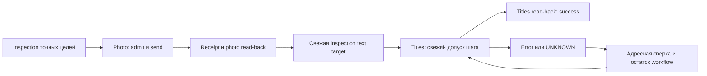

# AE Agent Core 4.0.0: границы и контракты

Статус: архитектурное предложение, 26 октября 2026. [Intent](core-4.0.0-intent.md), [этапы и приёмка](../plans/core-4.0.0.md). Целевые имена APIs и пакетов ниже ещё не реализованы; установленный runtime не меняется.

## Достаточное основание

Адресное чтение уточнило границы существующего пути: `mcp-server/core-tool-dispatch.js:7161` содержит guards comp/layer/previous-source/new-source у `replace_layer_source`; `:7368` у `update_text_layer` нет exact layer-ID/previous-text CAS. Внутренний `bridge-daemon.js:5127` принимает script, `cep-panel/panel.js:1803` передаёт `command.script` в `physicalEvalScript`; timeout после доставки в `bridge-daemon.js:5245` сохраняет неизвестный исход. Значит, перенос handlers требует нового закрытого admission seam и усиления text guards.

Причины общей связанности из стартового запроса приняты без повторного полного аудита: startup imports, предметные условия общего runner, общие `runtimeNamedHashSet`/sourcePins и проверка всего manifest. Static literal-require карта — приближение, не доказательство фактической загрузки или полноты межъязыковых связей.

## Владельцы и разрешённые зависимости

| Компонент | Владеет | Не содержит |
| --- | --- | --- |
| Permanent Core broker | Lifecycle, connection/reconnect/status/diagnostics, очередь/task epochs, единственный controller, generic admission, neutral resource/receipt ledger | Предметные builders, AE handlers, обход всех рабочих пакетов |
| MCP adapter | Стабильные generic JSON tools и ограниченные проекции ответов Core | Enum всех предметных схем при startup |
| Optional plan engine | Plan/workflow DAG, step dependencies, lifecycle, partial success/resume, контрактные bindings | Предметные builders/read-back, transport authority |
| Рабочий модуль | Operations/schemas, deterministic builders, validation, executor assets, read-back, свои проверки | Private ports Core, прямые CEP/transport calls, private imports соседей |
| Trusted executor-артефакт модуля | Фиксированные inspect/mutate/verify entry points, предметная семантика и identity CAS | Код из inputs/worker response |
| Один on-demand worker | Engine/module jobs вне event loop Core | Transport credentials, private grants, самостоятельный send |
| Декларативный catalog | IDs, версии, locations immutable artifacts, public dependencies/availability | Исполнение кода и выдача доверия |

Допустимые связи: adapter → Core protocol; Core → собственная closure и малый generic protocol/codec/schema слой; engine → public Core task/admission interfaces; module → module SDK и явно объявленные небольшие public libraries/contracts. Workflow связывает public contracts через engine, не импортирует private код модулей. Общий SDK не собирает предметные handlers. Реально общая библиотека имеет владельца, версию и список потребителей.

Без engine/модулей доступны status/connect/disconnect/reconnect/diagnostics/reset и нейтральный учёт незавершённых отправок. Недоступность engine запрещает новые plan runs, но не чтение receipts и удержание fences. Engine загружается в worker при plan/workflow запросе. Его durable step journal сохраняется вне памяти worker; engine владеет семантикой записей, Core — независимым command ledger и подтверждением сохранения результатов до продолжения.

## Discovery и стабильный MCP surface

Минимальная целевая группа: `list_modules`, `get_module_contract`, `inspect_module_target`, generic `build_solution_plan`, `propose_plan`, `dry_run_plan`, `run_plan`, `get_task`, `reset_task`, `reconcile_task`, плюс control/status tools Core. Прежние известные builder IDs могут иметь адресные compatibility aliases; они не загружают весь каталог.

Внешняя schema принимает ID и bounded JSON payload без enum всего набора функций. `get_module_contract` возвращает exact module/operation/schema identities; build указывает полученную contract identity, сервер валидирует payload по ней. Build детерминирован и не отправляет команд в AE. Proposal создаётся/канонизируется сервером, а не принимается как authority из worker.

`list_modules` читает ограниченный декларативный catalog snapshot с `catalogRevision`. Не выполняет require и не проверяет hashes всех packages. При выборе проверяется только выбранная immutable artifact closure. Catalog refresh атомарен; недоступный пакет возвращает unavailable, недопущенный — not admitted. Ошибка записи не ломает работающий Core. Новый discovery видит изменение без MCP reconnect; catalog revision не входит в Core identity или pins прежнего плана.

## Закрытый путь предметного исполнения

Выбран **worker intent + admitted executor artifact**, чтобы сохранить специализированный typed execution path вне Core.

| Вариант | Следствие |
| --- | --- |
| Lazy require в Core | Меньше изменений, но зависание module event loop блокирует управление |
| Worker с `execute(script)` | Изолирует зависание, сохраняет чрезмерную authority рабочего кода |
| Все AE primitives в Core | Создаёт общую предметную closure и общий выпуск заново |
| Worker JSON intents + admitted executor assets | Требует извлечения executor bundles и нового envelope; сохраняет locality и закрытый ingress |

Владелец модуля поставляет reviewed специализированный executor. Владелец релиза/установки отдельно допускает конкретный immutable artifact; заявления manifest этого не делают. Для M1 — два локально reviewed admission records, без универсальной plugin PKI/marketplace.

Один operation admission связывает `moduleId, operationId, schemaHash, resultSchemaHash, effectPolicyHash, executorHash, protocolVersion, trustApprovalId`. Hash определяет байты, trust record — допущенный код, private server grant — разрешённое сейчас действие над ресурсами. Все три условия обязательны.

Worker возвращает JSON intent: известная operation identity, typed input и references на server-owned evidence. `script`, произвольный executor path, executable expression, неизвестная операция и client-authored grant отвергаются. Сам Core:

1. Разрешает exact pinned operation через локальный admission record и актуальное отсутствие отзыва.
2. Читает immutable executor asset, не исполняя предметный Node/JS код в своём event loop.
3. Валидирует input/result schemas, бюджеты, trusted effect policy и references только в своих evidence records.
4. Применяет proposal/dry-run/confirmation, ownership/checkpoint, fresh resource checks и neutral fences.
5. Записывает durable command attempt до физической отправки; при отказе записи send запрещён.
6. Формирует закрытый typed transport envelope с выбранным executor и сериализованным payload; данные не интерполируются как executable tokens.

Core validator использует bounded non-executable schemas без remote refs/custom callbacks; предметные computational validators работают в worker и не выдают authority. Числовые бюджеты на старте M1: IPC frame ≤256 KiB, pending requests ≤32, один outstanding AE-command. Иные лимиты меняются явно и проверяются как contract change. Generic codec/header и нейтральный CAS envelope остаются transport кодом; предметный JSX находится в executor asset модуля.

Executor содержит fixed inspect/mutate/verify entry points. Предметный identity CAS выполняется в AE непосредственно перед mutation; read-back — отдельная фиксированная verify операция через тот же admission. Worker-authored `verified:true` не подтверждает успех. CEP принимает только envelope от единственного trusted controller с command/protocol/executor/payload bindings; физический evalScript — private transport detail, без publicly/module-facing unrestricted ingress. Старые пути прямого `command.script` не могут быть альтернативным входом в 4.0 control lane.

Первый этап допускает только reviewed локальные пакеты. Worker — изоляция зависания, **не OS sandbox**: защита от враждебного кода под тем же Windows user не обещается. Raw/manual операции не входят в M1 и не доступны через generic module API; их отдельные ручные gates сохраняются.

## Нейтральные resource constraints

Core records: `resourceIdentity, owner, revision, allowedEffects, reservation/fence, checkpointRef, commandRefs, unresolvedOutcome`. Нейтральные типы описывают project/session/item/layer/file/output ресурсы и effect surfaces, без импорта предметного пакета. Обязательные общие ограничения из прежних предметных веток извлекаются сюда, сохраняя исходную силу и provenance; отсутствие модуля не отменяет ограничения.

Footprint и максимальный effect определяет trusted admission policy, не worker. Например, photo может менять source одного layer, titles — text одного layer; оба сериализуются общим AE controller. Если footprint недостаточно доказан, используется более широкий project mutation fence или отказ. Модуль не снимает чужую reservation и не объявляет UNKNOWN безопасным. Недоступный/непонятный constraint schema сохраняет fence и диагностический статус, не разрешение записи.

`recordContext`, смена версии, новый чат/UUID и удаление пакета не являются authority или отменой команды. Core может стартовать для диагностики при unresolved состоянии; mutations соответствующих общих ресурсов остаются закрыты до reconciliation. Старые records не копируются/переиздаются как новые полномочия по факту установки 4.0.

## IPC и lifecycle одного worker

Request: `protocolVersion, requestId, workerEpoch, taskId, taskEpoch, method, componentPins, payload`. Reply повторяет correlation identities и содержит bounded result либо structured error. Unknown methods/extra fields/stale epochs/oversized frames отвергаются; executable callbacks отсутствуют. Worker может запросить typed inspection/command intent, Core решает допуск.

Core самостоятельно обслуживает heartbeat/deadline/status/reset и применяет IPC backpressure. Worker infinite loop/exit/malformed output не блокируют Core. После deadline процесс можно завершить; новый worker получает новую generation, старые ответы не создают sends. Worker restart не равен MCP reconnect или перезапуску Core/CEP.

Смена пакета допускает drain/recycle **одного** idle worker после прекращения новых jobs старой версии; pinned artifacts не подменяются. Pending/inflight AE остаются в Core и не освобождаются при recycle. Состояние engine восстанавливается из durable journal, а не из памяти worker. M1 не добавляет pool/process-per-module; последовательность — осознанный компромисс.

Reset увеличивает taskEpoch, удаляет queued-unsent работу и запрещает последующие dispatch этой задачи. Проверка epoch сериализована с dispatch commit. При гонке с уже зафиксированной попыткой отправки сохраняется conservative receipt. Поздний результат учитывается по старому commandId только для recovery; он не продолжает сброшенный workflow.

## Идентичности и immutable pins

| Identity | Область |
| --- | --- |
| Core artifact + protocol/admission policy | Только постоянная runtime closure |
| CEP transport artifact/protocol | Доставка, channel/controller binding, payload codec |
| Engine artifact | Lifecycle и workflow contracts |
| Module/executor artifacts | Собственные файлы, operations/schemas/effect policy |
| Явные shared dependencies | Public APIs и реальные потребители |
| Catalog revision | Discovery snapshot, не runtime pin всех функций |
| Exact trust admission record | Допуск данной операции; проверка отзыва отдельно |

Документы, catalog, рабочие пакеты и общий список trust records не входят в hash Core runtime. План закрепляет только exact closure реально участвующих компонентов, включая выбранные admission records и transport/protocol. Изменение чужого admission record не перепривязывает план. Глобальная смена самой admission policy — честное изменение общей зависимости.

Semver без content hash не закрепляет байты; hash без trust admission не разрешает исполнение. Выбранные artifacts копируются/публикуются immutable content-addressed способом и проверяются при подключении, чтобы каталог не создавал TOCTOU к mutable path. Revocation немедленно запрещает новые sends отозванной операции, но не стирает её receipts/UNKNOWN. Продолжение с новой версией titles создаёт новую plan revision, явно связанную с прежним photo result.

## Первые два модуля

`photo-placeholder`: existing project/comp/layer, уже импортированный still FootageItem, CAS expected previous/new source IDs. Замена сохраняет transform/timing; без file import/relink/fit, source item mutation и fixExpressions. Read-back фиксирует новый source и защищённые свойства.

`titles`: существующий статичный text layer, exact project/comp/layer и expected previous-text fingerprint/value. Меняется только текст, формат сохраняется. Animated/expression и неподтверждённые mixed-style случаи получают unsupported. Нужны усиление текущего handler и адресное доказательство сохранности поддерживаемого стиля.

Адресное уточнение при реализации: Adobe подтверждает появление ExtendScript `CharacterRange`/`ParagraphRange` в [AE 24.3](https://helpx.adobe.com/after-effects/desktop/using/whats-new/2024-3.html). Отсутствие нужного API, неоднозначность range values или ошибка чтения означают unsupported. Подробные официальные страницы [TextDocument](https://developer.adobe.com/after-effects/uxp/after-effects-api/textdocument) и [CharacterRange](https://developer.adobe.com/after-effects/uxp/after-effects-api/characterrange) относятся к UXP/Min27.0: их нельзя автоматически переносить на ExtendScript24.3. Старый first-character preview не доказывает uniform style; присваивание `.text` само по себе не доказывает сохранность всех style attributes. M1 фиксирует поддержанный набор и независимый before/after read-back; actual live round-trip остаётся отдельной приёмкой.

## Mixed workflow: photo + titles

Идентичности: `workflowId` — работа; `planRevision` — серверная редакция; `runId` — выполнение/продолжение; `stepId` — стабильный шаг; `attemptId` — его попытка; `commandId` — физическая отправка. Одинаковый stepId с другим operation/input digest не считается тем же успешным действием.

1. Trusted inspection устанавливает exact project, photo/source и text target. Engine строит два pinned шага, titles зависит от verified photo result.
2. Server-owned workflow proposal описывает разрешённые effects, порядок, inputs и typed late bindings. Structural dry-run не выдаётся за freshness будущего шага.
3. Photo проходит свежие step proposal/dry-run/confirmation по риску, исполняется, получает durable receipt и независимый read-back до продолжения.
4. После photo повторно читается text target в том же проекте. Output/input contracts передают `projectRef, targetRef, sourceRef, writeSet, readbackEvidenceRef` и dependency proof, а не private objects.
5. Core материализует titles step proposal с новой evidence и exact expectations, выполняет свежий dry-run. Late binding разрешён только внутри заранее объявленного scope; новый target/effect/input вне утверждённого намерения требует новой редакции/подтверждения. При старом dry-run execution запрещён.
6. Titles исполняется и проверяется отдельно. Durable step results сохраняют pins и evidence обеих частей.

ProjectRef включает доказанную project/session binding и точные item/layer IDs. `sessionId` здесь означает trusted project-incarnation epoch, а не время жизни broker/channel: new/open/revert/replacement AEP ротирует binding даже при том же пути и item/layer IDs. При неизвестном lifecycle producer live admission unavailable; одна глобальная строка без такого происхождения не доказывает идентичность проекта. Path/name/index — подсказки поиска, не identity. Наблюдение содержит capture epoch и fingerprints нужных свойств. TTL или внутренний revision counter не доказывает отсутствие ручных изменений: executor сравнивает реальные identities/expected state в AE перед записью. Offline fixture отдельно моделирует повторное открытие того же пути/IDs с новой session.

| Состояние после photo success | Продолжение |
| --- | --- |
| Titles отказал до send | Сохранить photo result, новая попытка только titles после fresh inspection/admission |
| Titles дал UNKNOWN после send | Сначала reconcile исходный commandId; setter не повторять |
| Read-back подтвердил нужный текст и завершение попытки | Закрыть прежнюю попытку recovery result; не создавать повторный mutation |
| Доказаны прежний текст и завершение/неисполнение старой команды | Возможно отдельно допустить новую titles попытку |
| Не доказан исход/завершение | Оставить fence и UNKNOWN |
| Photo уже изменён пользователем | Показать drift и остановить зависимое продолжение до нового решения; photo не переигрывать |
| Reset после photo | Photo остаётся succeeded; queued titles отменён, уже отправленный titles сохраняет receipt |

Resume создаёт новый runId/attemptId только остатка и ссылается на исходный verified photo result. При его адресной проверке нельзя считать один output неизменно свежим навсегда. Произвольный атомарный rollback всей цепочки не обещается.

## Receipts и UNKNOWN

Delivery axis: `queued_unsent → dispatch_attempted → acknowledged/in_AE → result_received → verified`. Статусы failure/reset/UNKNOWN и ресурсные ограничения хранятся отдельно: ACK доказывает свою границу доставки, не предметный успех.

Durable attempt фиксируется до send. После него crash/timeout может оставить UNKNOWN даже без ACK. Core хранит commandId, provenance, resource/effect set и pins при reset, worker restart и отсутствии engine. Reconnect не возобновляет mutation автоматически.

Reconciliation использует original receipt, доказательство завершения/неисполнения и fresh read-only fixed verifier точных ресурсов. Совпадение значения без доказательства завершения не снимает fence: старый ExtendScript ещё может исполниться. UNKNOWN не повторяется из-за одинаковых аргументов или нового runId. Crash windows до/после send/ACK/read-back должны быть отдельными fixture cases M1.

## Детерминированный выбор проверок

Вход: diff + versioned ownership map + manifests public dependencies/contracts + check registry. Check selection возвращает machine-readable список `checkId, owner, reason, dependencyPath, evidenceKey`; полный release mode вызывается отдельно.

1. Каждый changed path получает одного owner. Неизвестная/неоднозначная область означает пробел и отказ scoped-certification; требуется адресно дополнить карту, не молча объявить локальный PASS.
2. Классифицируется internal/public API/executor-effect/shared runtime/catalog/docs изменение.
3. Вычисляется affected contract closure и reverse dependency paths. Изменение shared implementation может затронуть потребителей и без смены schema; dependency manifest обязан отражать это.
4. Owner checks обязательны. Component conformance выбирается также по изменению её фактической dependency; public contracts, явно заявленные semantic impacts и shared-runtime edges выбирают соответствующих consumers. Каждая проверка имеет reason и dependency path.
5. Фактическая byte closure каждой проверки сохраняется независимо от обязательности её запуска. Затронутые широкие integration checks, не обязательные в текущем scope, перечисляются в `deferredCoverage` как `current-closure-unverified`; их прежний PASS не переносится на новые байты. Для такого отчёта не требуется читать/хешировать отсутствующие пакеты deferred closure.
6. Обновляются лишь manifests/pins изменённых artifacts и применимость зависимой evidence; неизменённые результаты сохраняются. Прочитанный проверкой неизменённый photo-файл сам по себе не становится новым diff и не запускает каскад photo-owner.

| Diff | Выбранные проверки / причина |
| --- | --- |
| Titles private-file implementation diff | Titles behavior + executor contract fixtures; затронутая широкая integration evidence явно deferred для новой closure, без photo prerequisite |
| Titles input/output/schema или exposed semantics | Titles contract и объявленные consumers, включая mixed binding |
| Photo executor/effect policy | Photo behavior/identity/read-back и admission/fence fixtures |
| Shared IPC/admission/target contract | Затронутые interface fixtures и объявленные потребители по dependency paths |
| Catalog entry | Catalog schema/resolution; выбранный artifact проверяется при подключении |
| Только документы | Ссылки/согласованность/формат; продуктовые suites не запускаются |

Static graphs помогают найти пропущенные связи, но не заменяют явные contracts и не выбирают tests как authority. Evidence key включает check/producer identity, selected artifact/dependency hashes, contract versions, fixture identity и релевантную среду. Изменение элемента key инвалидирует соответствующий результат и зависимые выводы. Уже валидная evidence остаётся исторически действительной для прежних artifacts; свежие resource inspection, grants и dry-runs не кешируются как кодовая сертификация. Offline proof не является live/visual/save-reopen acceptance.

Уточнение implementation review: `checkPolicy` разделяет component conformance и integration по реальному содержимому проверок. Общая группа с настоящими broker/engine/modules остаётся integration даже с именем `core-control`; изменение её owner всё равно требует её запуска. Для shared Core явно объявляются consumer edges: например, resources затрагивает оба module conformance и workflow recovery. Нельзя удалять реальные dependencies из keys ради локальности.

`private-file diff` не доказывает неизменность публичной семантики. Намеренное изменение поведения без смены schema объявляется через `contractImpacts` и выбирает consumers. Без этого scoped result утверждает только пройденную conformance; deferred integration остаётся непроверенной для текущей closure. Успешный `--run` не является release PASS и не утверждает существование cached PASS, если такой записи нет. Это отделяет стоимость обязательного локального запуска от честной применимости evidence.

## Компромиссы и адресные evidence gaps

Выбраны один worker, reviewed локальные пакеты, два узких executor bundles и поэтапный recovery. Это сохраняет малую control closure ценой IPC/contracts и последовательной рабочей очереди. Поддержка hostile plugins потребует отдельной OS isolation модели и не входит в обещание 4.0 M1.

Перед соответствующей реализацией нужны адресные fixtures нового CEP envelope/codec, crash durability и переноса neutral fences. Перед live — доказательство lifecycle exact project/layer identities, text-style сохранности в поддерживаемом scope и актуальное pending/shared-resource состояние. Это конкретные пробелы evidence, а не требование повторного аудита всех исходников или завершения прежнего cutover.
