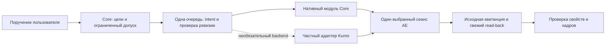

# Аудит монтажа, автономности Core и совместной работы с Kumo

9 ноября 2026. Это аудит и предлагаемый план, не реализация и не разрешение на изменение runtime. Время инцидента — Asia/Yekaterinburg, UTC+5.

## Вывод для выбора направления

Развивать Core имеет смысл как самостоятельный инструмент для повторяющихся рабочих сценариев пользователя: Titles, Slideshow, замена/наложение медиа, проверяемое сохранение и выпуск. Строить полный аналог всех функций After Effects до решения текущих задач нецелесообразно. Ближайшая полезная цель — выполнить тот же монтаж сложных фотоплейсхолдеров без Kumo, ручного поиска слоёв и восстановления через удалённый рабочий стол.

После повторного ревью с исходниками выбран ближайший путь: исправить общие причины простоев, затем проверить один ограниченный нативный Core-контракт duplicate/replace с возможным переносом MIT-примитивов Kumo. Статическое сравнение уже выявило существенный разрыв штатного Kumo 0.3.2 на границе сохраняемых квитанций и восстановления исхода; runtime-адаптер для мутаций в том же AE исключён из ближайшего scope. Это не запрет на любой будущий адаптер, но для него потребуется отдельное обоснование цены переработки. Два непосредственно доступных MCP, пишущих в один AE, не образуют единую систему безопасности.

**Окончательный архитектурный вердикт:** развивать самостоятельный Core для выбранных workflows: единая точка входа, допуск, очередь, история и проверяемые композиционные операции. Повторно использовать подходящие MIT-примитивы внутри модулей, сохраняя атрибуцию. Внешний Kumo оставить необязательным инструментом для изолированных процессов и рабочих копий. Его установка сама по себе не означает конфликт и не требует удаления. Новые модули Core обязаны отдельно доказать корректность partial/late outcome; нахождение внутри Core не обеспечивает этого автоматически. Полный аналог всех функций AE не является целью.

Kumo — локальный open-source MCP, а не обязательный облачный сервис. Независимость от Kumo означает отсутствие обязательного внешнего AE-исполнителя. Она не означает независимость от Adobe, ОС, шрифтов, плагинов или облачной генерации изображений. ImageGen и рассуждающая модель — отдельный слой, который Core может использовать через заменяемые поставщики готовых файлов.

## Основания и пределы аудита

- Исходники Core: `57689fe5ee46ac338358e6f8af42f66b4a0f1f74`.
- Установка на диске: пакет `582744df1a5c1a6d7e235f28549cc0884ab6ca7e5f183e98c6fadce6087b7a8d`. SHA-256 шести рассмотренных executor-файлов совпали между source, standalone и установленным release. Поэтому перечисленные ограничения этих файлов относятся и к установленным bytes. Текущее состояние процесса/lease этим не удостоверено.
- Дополнительно source и installed `project-save-proof.js` совпали по SHA-256. Текущий рабочий AEP на диске имеет размер 95 724 372 байта (около 91,3 МиБ), больше лимита 64 МиБ. Его mtime — 9 ноября 01:48:57 UTC+5, позднее рассматриваемого монтажа; этот замер не доказывает размер или сохранённость состояния в начале инцидента.
- Локальный Kumo: `@kumoproductions/mcp-aftereffects` 0.3.2; прочитаны установленные `dist/policy.js`, `tools/do.js`, `operations/batch.js`, `operations/instance.js`, `transport/FileIpcTransport.js`, `transport/dialogs.js`. Онлайн дополнительно проверены [официальный репозиторий](https://github.com/kumoproductions/mcp-aftereffects), [каталог tools](https://github.com/kumoproductions/mcp-aftereffects/blob/main/docs/TOOLS.md), [transport](https://github.com/kumoproductions/mcp-aftereffects/blob/main/src/transport/FileIpcTransport.ts). Онлайн `main` не считается доказательством идентичности установленного пакета.
- События монтажа проверены в rollout текущего чата `01a1bb7a-970f-7680-85fe-6b65faa3452c`. Обезличенные метки времени и хеши: [evidence](evidence/core-autonomy-audit-20261109.json). Полный журнал, изображения, AEP и credentials в аудит не копировались.
- Независимый source-разбор выполнен ролью `ae_architect`, Sol 6.1 XHigh. Исходники, runtime, конфигурация и проект AE не изменялись. Нативные проверки и испытания отказов в этом аудите не запускались.
- Причина первого отсутствующего native-ответа не доказана полностью. Для повторной неудачи наблюдалось модальное состояние AE после открытия. Нельзя задним числом приписать все timeout одной причине.
- Причина невозможности удалённого подключения пользователя неизвестна: нет журналов используемого remote-access приложения, сети и интерактивной Windows-сессии. Это отдельный диагностический пробел, не доказанный дефект Kumo или Core.

## Как распределилась задержка

| Событие | Местное время | Значение |
|---|---|---|
| Запрос разрешения восстановить Core | 8 ноября, 19:16:28 | Генерация продолжалась независимо от блокировки AE |
| Основной первоначальный набор изображений подготовлен | около 19:26 | Не включает поздний дневной вариант фасада |
| Разрешение переоткрыть AEP | 22:20:06 | До этого восстановление с закрытием AE ожидало решения |
| Второй вопрос о dirty AEP | 22:21:51 | Первый вопрос обещал не сохранять; возник отдельный выбор судьбы правок |
| Разрешение сохранить текущий AEP | 9 ноября, около 00:02 | Сохранение выполнено около 00:06 |
| Повторное чтение после первого reopen | 00:12:24 | Сделано до достаточной готовности AE; возник новый затор |
| Успешное чтение Core и освобождение управления | около 00:25:29 | После второго восстановления и появления рабочего кадра |
| Пакет коллажа, 19 операций | 00:28:54.473–00:28:55.464 | Около 0,991 секунды между вызовом и ответом; это не время всей подготовки |
| Пакет ночного фасада | 01:04:51.657–01:04:52.079 | Около 0,422 секунды |
| Пакет дневного фасада | 01:20:54.927–01:20:55.348 | Около 0,421 секунды |

Ожидание первого ответа заняло примерно 3 ч 4 мин, второго — 1 ч 40 мин; часть первого ожидания перекрылась генерацией. Это elapsed ожидание, не процессорное время и не медленная работа AE. Суммарный интервал трёх пакетов монтажа — около 1,83 секунды. Он не включает чтения, составление плана, подготовку alpha/размеров, новые изображения и проверку кадров. Между пакетами были уточнение рабочего варианта первого слайда, генерация дневного изображения и проверка результата. Журнал не позволяет честно приписать каждую минуту конкретной модели или backend генерации.

## Реестр проблем и исправлений

### A1. Чтение превращается в общий стоп работы — P0

**Факт.** Native timeout приводит к неизвестному исходу и блокировке физического канала. При этом `owner_outcome_uncertain` может возвращаться и без записанного physical fence. Прямой `project-inspection-v1` имеет специальную классификацию некоторых терминальных отказов; сообщения разных путей недостаточно различимы. Исторически истёкший dry-run также давал внешне похожий отказ до dispatch.

**Исправление.** Разделить состояния: отказ до отправки; запрос ещё не выдан AE; доказанный терминальный отказ; доставленное и незавершённое чтение; неизвестная мутация; неизвестная запись внешнего файла. Возвращать command ID, фазу, подтверждённый terminal receipt, состояние очереди и следующий допустимый шаг. Вместо неоднозначного boolean `dispatchOccurred` различать intent recorded, handed to poll, native accepted/began и terminal, с состоянием `unknown` для недоказанной границы. Текущее `delivered=true` ставится до HTTP-ответа и не удостоверяет начало исполнения AE; timer способен записать UNKNOWN и без poll. Не делать вывод о фактическом fence только из строки ошибки.

Для точного доверенного `effect:none` предусмотреть восстановление без закрытия AE после доказанного завершения/погашения старой доставки и проверки привязки сеанса. Не отпускать очередь только потому, что операция названа чтением. Неизвестный callback и verify после мутации не становятся безопасными от нового read-back. PNG-export пишет внешний файл и к `effect:none` не относится.

**Приёмка.** Доказанный отказ до dispatch не требует restart. Отдельно проверить отсутствие poll, потерянный poll-ответ после отметки handoff и поздний callback; перед восстановлением доказать quiescence и совпадение session binding. Позднее чтение не пересекается с новой записью. Потерянный ответ мутации продолжает блокировать повтор. История сохраняется; расхождение response и physical state явно видно.

Источники: [http-peer.js:47](../core4/integrations/cep/http-peer.js#L47), [терминальный inspect:201](../core4/integrations/cep/http-peer.js#L201), [attachment-owner.js:128](../core4/runtime/attachment-owner.js#L128), [broker reconcile:409](../core4/core/broker.js#L409).

### A2. Connected приняли за готовность AE — P0

**Факт.** После reopen запрос ушёл до завершения модального/загрузочного состояния. Ошибка оператора удлинила восстановление; интерфейс Core не дал достаточного различения CEP connected и native-ready.

**Исправление.** Разделить `process alive`, `CEP connected`, `loading`, `modal blocked`, `native ready`, `baseline required`. Вынести наблюдение окон за пределы ExtendScript, поскольку сам скриптовый канал блокируется диалогом. Указать PID/время запуска/идентичность диалога, результат и достоверность сканирования. Ошибка сканирования не должна означать «диалогов нет». После исчезновения диалога — ограниченный безопасный handshake и baseline, а не серия повторов монтажа. Видимый кадр полезен как дополнительный признак, но не доказательство готовности канала.

**Приёмка.** Missing fonts, missing footage, save prompt, загрузка большого AEP, скрытое окно и зависший AE различаются. Неизвестный диалог не подтверждается автоматически. Утверждённое информационное окно можно обрабатывать точным правилом, вопрос о сохранении — отдельным действием согласно политике задачи.

Источники: [poll-dispatcher.js:32](../core4/cep/js/poll-dispatcher.js#L32); локальный Kumo `dist/transport/dialogs.js:358–434` уже показывает подход OS-level scan/cancel, который можно изучить или переиспользовать с MIT-атрибуцией, а не изобретать заново.

### A3. CLI и панель по-разному разрешают reset — P0

**Факт.** CLI требует `ready`, панель считает пригодным для запроса также `baseline-required`. При повторном сбое это привело к `start_over_operator_busy`; Computer Use не смог адресовать дочернее CEPHtmlEngine-окно.

**Исправление.** Единый серверный предикат eligibility с одинаковыми причинами для CLI и панели. Раздельно показывать необходимость baseline и незавершённый запрос. Это исправление согласованности клиентов, а не ослабление authenticated backend. У supported recovery должна быть документированная команда без зависимости от координат кнопки.

**Приёмка.** CLI/панель совпадают на `ready`, `baseline-required`, unresolved read, pending mutation, stopped owner и чужой привязке. Двойное нажатие/повтор команды не запускают второй reset.

Источники: [operate-start-over.js:43](../core4/tools/operate-start-over.js#L43), [panel.js:14](../core4/cep/js/panel.js#L14), [stdio-entry.js:348](../core4/runtime/stdio-entry.js#L348).

### A4. Согласование восстановления разбито на два ожидания — P0 UX

**Факт.** Исходное поручение достаточно определяло монтаж. Дополнительные вопросы возникли о закрытии AE и судьбе несохранённых правок, а не о том, с каким проектом работать. Обещание «не сохранять» в первом запросе сделало последующий dirty-state отдельным блокером.

**Исправление.** До запроса восстановления собрать доступные read-only факты. Если требуется решение, показать один конкретный recovery plan с условием для dirty-state: что сохраняется, куда, что переоткрывается, что остаётся запрещено. Уже полученную авторизацию сохранять в задаче; не спрашивать снова при тех же условиях. Открытая пользователем comp — хороший исходный контекст, затем система сама связывает её с точными IDs.

Для автономного монтажа использовать ограниченный допуск задачи: конкретный проект/сеанс, цели, набор файлов, разрешённые overlay-операции и PNG, отдельная политика save/reopen, запрет video render и удаления оригиналов. Технические одноразовые grants получать на основании этого допуска, а не заставлять человека подтверждать каждый tool. Существующий operator-confirmation уже позволяет части профилей работать без окна Core; его нельзя представлять как отсутствующую возможность. Расширение на lifecycle требует отдельного контракта и приёмки.

**Приёмка.** Обычный разрешённый overlay не требует присутствия у ПК. Расширение списка целей, смена AEP, новое разрушительное действие или неразрешённый save корректно останавливаются. Истечение, отмена и перезапуск не расширяют допуск. Состояние «жду решения» остаётся доступно в чате и не зависит от RDP; защищённый отдельный remote-approval интерфейс — лишь возможное дальнейшее развитие, не обязательный новый сервис.

Источники: [operator-confirmation.js:37](../core4/runtime/operator-confirmation.js#L37), [manual-policy.js:58](../core4/runtime/manual-policy.js#L58), [broker.js:263](../core4/core/broker.js#L263).

### A5. Поиск композиции может ложно вернуть not found — P0 корректность

**Факт.** `project-inspection` рассматривает первые 500 project items, до 50 comps и 100 layers. Точный comp ID вне первых 500 не находится. `saved` означает наличие пути, а не отсутствие несохранённых изменений.

**Исправление.** Адресный поиск по ID не ограничивать первой страницей discovery. Для перечисления добавить pagination и cursor, связанный с ревизией; существующий `truncated` дополнить точными пределами покрытия. Возвращать `dirty`, активную comp и work area отдельно от inventory. Различать `not_found` и `scan_incomplete`.

**Приёмка.** Нужная comp на позиции 501/1079 находится по ID. Дубли имён не смешиваются. Dirty AEP с существующим путём никогда не выдаётся как clean.

Источник: [project-inspection/executor.jsx:7](../core4/modules/project-inspection/executor.jsx#L7).

### A6. Ограничения больших проектов распределены по модулям — P1

**Факт.** `media-import`/`layer-insert` ограничены 512 items, `project-lifecycle` — 256 items/24 KiB, вставка также ограничивает глобальное число слоёв, target stack, uses и revision bytes. `project-save` использует доказательство файла до 64 МиБ; текущий рабочий AEP на диске — 95 724 372 байта, около 91,3 МиБ. Этот профиль сохранения не подходит текущему файлу даже после восстановления связи. Это source/filesystem-вывод, не новый пробный save и не установленная причина исторического сбоя. При lifecycle open предел нового проекта может сработать после `app.open`.

**Исправление.** Единый capability preflight по реальному проекту до генерации/монтажа. Разделить ограничения вывода и безопасного выполнения. Использовать адресные snapshots и детерминированные digest больших инвентарей, с явным бюджетом времени/объёма и покрытием. Для больших AEP рассмотреть потоковое хеширование/копирование checkpoint с сохранением file-identity и before/after stamp guards вместо загрузки целого файла в память. Простое повышение всех констант или удаление guards переносит проблему в transport и proof. Для open, где полное состояние заранее неизвестно, нужны специальная post-open reconciliation и честное состояние частичного исхода; нельзя обещать всегда отказ до записи.

**Приёмка.** Границы 255/256/257, 499/500/501, 511/512/513 и реальный 1079+ проект. Большой целевой AEP, длинные имена, много uses/слоёв; доказанное отсутствие скрытого truncation. Большой файл save получает конкретное объяснение профиля до опасного шага, где это возможно.

Источники: [media-import:16](../core4/modules/media-import/executor.jsx#L16), [layer-insert:67](../core4/modules/layer-insert/executor.jsx#L67), [project-lifecycle:7](../core4/modules/project-lifecycle/executor.jsx#L7), [project-save-proof:6](../core4/runtime/project-save-proof.js#L6).

### A7. Нет операции overlay с наследованием сложного слоя — P1

**Факт.** `layers.add` создаёт новый слой; `photo-placeholder` заменяет источник исходного слоя в ограниченном 2D/static профиле. Они не равны требуемому duplicate + replace source. Ручной перенос всех масок/эффектов значительно сложнее нативного duplicate.

**Исправление.** Один typed `duplicate-and-replace-still`: исходный layer ID, новый source ID, AEP/session/comp ID, ожидаемая ревизия и положение непосредственно над оригиналом. Duplicate и replace выполняются в одном ограниченном native участке. Проверить ID/порядок оригиналов, оригинальный source, новые IDs, timing, transforms/keys, поддерживаемые masks/effects, parent/matte и alpha. Не обещать произвольные plugin-свойства до доказанной поддержки. Ссылки/геометрия источника и диапазон действия shared comp входят в preflight.

**Приёмка.** Коллаж, повтор одного фото с разными масками, alpha-портрет, ключи/эффекты, общие прекомпы; оригиналы остаются неизменными. Отказ после duplicate оставляет распознаваемый частичный результат и не приводит к второму дубликату при повторе. Cleanup только своего установленного результата, с проверкой внешних ссылок.

Источники: [layer-insert:157](../core4/modules/layer-insert/executor.jsx#L157), [photo-placeholder:106](../core4/modules/photo-placeholder/executor.jsx#L106), [legacy duplicate:4846](../mcp-server/core-tool-dispatch.js#L4846), [legacy replace:7161](../mcp-server/core-tool-dispatch.js#L7161).

### A8. Слишком общий запрет выражений, но просто убрать его нельзя — P1

**Факт.** Вставка отказывает при enabled expressions и некоторых layer-index свойствах во всём проекте. Это безопасно, но делает обычные шаблоны практически недоступными.

**Исправление.** Проверять влияние вставки на затронутый стек и ссылки из других comps. Не ограничиваться деревом предков: expression может обратиться к любой comp по имени и к слою по индексу. Для подтверждённых шаблонов поддержать конкретные профили; динамические неразрешимые ссылки явно отклонять или направлять в изолированную рабочую копию с отдельной приёмкой. Не менять `fixExpressions` и выражения молча.

**Приёмка.** Безопасное нерелевантное выражение не блокирует всё; index-based ссылка, динамическое имя, layer-control и matte не повреждаются. Одного красивого кадра недостаточно для доказательства сохранности анимации.

Источник: [layer-insert/executor.jsx:25](../core4/modules/layer-insert/executor.jsx#L25).

### A9. Не хватало снимка рабочего контекста — P1

**Факт.** В проекте были разные `Final Comp`, верхний baked MP4 и разные версии первого слайда. Между начальным состоянием и рабочим монтажом пользователь отключил видео. Потребовались повторная привязка сцены и дневная версия изображения.

**Исправление.** В начале фиксировать active comp ID, work area, stack/visibility, текущий кадр, источники видимого результата и shared-use graph. После ручных изменений обновлять baseline и сравнивать именно затронутые сцены. Не добавлять все встреченные варианты в scope автоматически. Если выбор художественно неоднозначен, запросить его рано, продолжая независимую работу.

**Приёмка.** Две одинаково названные comps, отключённый верхний MP4, remap/stretch и общий placeholder не ведут к правке невидимой или чужой сцены.

### A10. Computer Use был частично необходим, частично следствием пробелов — P0/P1

| Что делалось | Фактическое объяснение | Как сократить |
|---|---|---|
| Просмотр таймлайна, поиск/раскрытие композиций и источников, перемещение панели | Core недоступен; штатная краткая инспекция не давала требуемой структуры | Адресные details/context/dependency reads и кадры через Core |
| Закрытие окон Adobe | Скрипты AE не выполняются при modal | Внешняя typed диагностика окон; точные правила допустимого cancel/ack |
| Ctrl+S, Ctrl+Q, reopen AEP | Сохранение/открытие Core существуют, но канал был fenced | Штатный recovery orchestration с политикой dirty-state и готовностью после reopen |
| Попытка кнопки «Начать заново» в CEP | CLI/panel divergence; граница дочернего процесса недоступна CUA | Общий серверный recovery API; не обходить отказ другим UI backend |
| Контроль внешнего вида | Визуальная оценка нужна по сути задачи | Готовый PNG и просмотр изображения не требуют кликов по AE |

Размещение фото и финальные PNG выполнялись Kumo typed tools, не мышью. Некоторые старты AE выполнялись через ОС, не через Computer Use. У Kumo есть `instance.dialogs` и `instance.dismiss_dialog`; прежнее утверждение об отсутствии внутренних tools было слишком широким. Эти команды не доказывают возможность безопасно разблокировать уже UNKNOWN Core: диагностика окна и завершение незавершённой команды — разные действия. Доступность команд в установленном коде подтверждена, пригодность для того конкретного окна/активной policy не испытывалась.

### A11. Переключение на Kumo не было заранее прозрачно — P0 процесс

**Факт.** Kumo использован после успешного восстановления Core, не для повторной неизвестной мутации. Но пользователь ожидал Core, а выбор исполнителя был объяснён лишь после вопроса.

**Исправление.** Перед исполнением показать кратко: выбранный backend, конкретный пробел Core, обязательность/необязательность зависимости и актуальную границу гарантий. Сохранить backend/версию/command IDs в manifest задачи. Не просить лишнего согласия там, где текущая авторизация уже покрывает действие, но не скрывать смену системы исполнения.

### A12. Слишком много времени вокруг быстрых операций — P1 workflow

**Исправление.** Один снимок сцены и реестр целевых замен; пакетная подготовка файлов; повторное использование неизменённых фактов; одна группа mutation + адресный read-back; PNG только для заранее выбранных сцен/переходов. Таймеры отдельно: ожидание пользователя, reasoning, generation, file preparation, AE dispatch, recovery, visual review. Не выдавать wall-call duration за AE CPU.

Сначала устранить блокировку и ошибки выбора цели. Ускорение уже секундного batch не решит пятичасовой затор. Добавить метрики: доля задач без человека у ПК, число подтверждений, restart после read failure, p50/p95 времени сценария без генерации, повторные imports/duplicates, объём входного контекста и токены по исполнителям. Для модели/усилия фиксировать runtime metadata, не предполагать их по имени чата. Для Аргона/ImageGen покрытие токенов отдельное и может отсутствовать.

### A13. Автономность без удалённого рабочего стола не оформлена — P0 UX/P2 эксплуатация

Core не должен требовать удалённый вход для обычного монтажа, уже разрешённого из чата. Требуются task authorization, возобновляемая задача и понятное уведомление, что именно остановилось. Наличие канала связи с чатом не заменяет новый пользовательский выбор, если он действительно нужен. Неизвестное окно, неизвестная мутация или неразрешённая потеря dirty-state могут оставаться законным блокером.

Отдельную причину сбоя удалённого доступа следует устанавливать только по фактам его приложения/сеанса. Не открывать RDP, порты, не менять UAC/автовход/учётные записи ради устранения симптома. В текущем аудите таких действий нет.

## Что даёт Core по сравнению с Kumo

| Потребность | Kumo в изученном пакете | Core сейчас / необходимая доводка |
|---|---|---|
| Быстро выполнять широкий набор AE-действий | Широкий registry, batch, details, duplicate/replace, PNG; практический монтаж прошёл | Узкие предметные модули; рассматриваемый overlay пока отсутствует |
| Ограничения и валидация | Read-only, category allowlist, проверка args, raw eval выключен по умолчанию, отдельный consent для app config | Server-owned plans, точные targets/revision, proof/checkpoints и ограниченные профили |
| Очередь | Сериализация клиента; push busy-lock; pull resident queue | Координация cooperating Core clients и durable command lifecycle |
| Отказ/тайм-аут | Различает request ещё не взят/уже взят; предупреждает о продолжающейся операции; OS modal scan | Durable receipts, reconcile и консервативный UNKNOWN; UX и классификация чтения нуждаются в исправлении |
| Пакет и Undo | Batch в одной Undo group; default `stopOnError=false`; автоматического rollback в batch-коде нет | Собственные proof/ownership/recovery; тоже нельзя обещать транзакцию всего AE/файлов |
| Задача «замени конкретные слоты и сохрани шаблон» | Должна быть собрана вызывающим агентом из операций | Именно здесь полезен предметный модуль с инвариантами и воспроизводимой приёмкой |
| Поставка между машинами | Node/npm, обычный single-instance путь без CEP, resident agent для нескольких AE | Закреплённые modular packages и проектная приёмка MSI/desktop; цена — больше lifecycle-механизмов |

Источники Kumo: [README](https://github.com/kumoproductions/mcp-aftereffects#readme), [batch](https://github.com/kumoproductions/mcp-aftereffects/blob/main/src/operations/batch.ts), [policy](https://github.com/kumoproductions/mcp-aftereffects/blob/main/src/policy.ts), [transport](https://github.com/kumoproductions/mcp-aftereffects/blob/main/src/transport/FileIpcTransport.ts). Фактические детали таблицы также сверены с локальным `dist` 0.3.2.

Уникальная польза Core должна измеряться тем, что система сама выполняет оговорённую задачу, сохраняет пользовательские свойства, объясняет partial outcome и безопасно продолжает её. Наличие дополнительного экрана подтверждений или журнала само по себе не является преимуществом. Если после доводки Core требует больше вмешательств, чем Kumo с тем же результатом и приемлемой для пользователя защитой, развитие универсального Core надо пересмотреть. Уже потраченные усилия не являются аргументом продолжения.

## Четыре варианта развития

| Вариант | Плюсы | Минусы и подводные камни | Когда оправдан |
|---|---|---|---|
| A. Самостоятельный Core для выбранных workflows | Один authority, единая поставка/приёмка, нет обязательного Kumo | Нужно закрыть large-project/readiness/overlay; новые семьи AE требуют отдельной поддержки | Повторяемые профессиональные задачи и требование восстанавливаемости |
| B. Core + управляемый Kumo backend | Повторное использование широкой реализации; единый пользовательский workflow | Адаптер обязан согласовать host identity, dispatch, receipts, partial/late results; не автоматически дешевле native модуля | Много реально нужных разнородных операций, чей перенос дороже адаптера |
| C. Два прямых MCP в одном AE | Быстрый ручной выбор инструмента, почти нет начальной разработки | Нет общего lock/ревизии/истории; неподтверждённые late callbacks; ошибочная уверенность в защите Core | Временная последовательная работа с явным handoff, ограниченными гарантиями |
| D. Kumo как основной AE-инструмент | Минимум собственного кода, широкий охват уже сейчас | Workflow/proof/recovery остаются у вызывающего агента; часть требований надо реализовать вокруг него | Редкие разовые операции, работа на копиях, готовность принять эти границы |

Сложность A ограниченного overlay — средняя, полного «всё AE» — очень высокая и открытая. B требует существенной начальной работы на границе доверия; C дешёв в настройке, дорог в разборе гонок; D дешевле по собственному сопровождению, но не бесплатен по проверке результата. Это сравнительная оценка, не оценка человеко-дней: для сроков нужны выбранный scope и короткий проверенный прототип.

Самостоятельный Core не обязывает писать каждый примитив с нуля. Можно использовать проверенные решения legacy и разрешённые MIT-фрагменты Kumo внутри собственного модуля с сохранением атрибуции и соответствующим аудитом зависимостей. Это убирает обязательный второй MCP-процесс, но ответственность за обновления и исправления принятого кода переходит к Core. Полный fork Kumo только ради нескольких примитивов в этот план не входит.

### Как совместить безопасно

Предлагаемая схема для варианта B; управляемый адаптер ещё не реализован:

Ветви N и K — альтернативные исполнители сериализованных операций одного сеанса, не два параллельных writer. Независимая прямая запись в этот AE остаётся вне гарантий схемы.

1. **Раздельные AE-процессы и рабочие копии.** Наиболее ясная независимая параллельность. Отдельные AEP, output paths и владение файлами. Копия с диска не содержит dirty правки памяти. Merge не является бесконфликтным объединением исходного графа: возможны новые IDs, дубли и изменённые ссылки; импорт результата — отдельный проверяемый шаг. CPU/RAM/плагины и лицензирование ограничивают число workers.
2. **Последовательные сеансы в одном AE.** Завершить и установить исход всех команд старого backend, прекратить выдачу новых, передать управление, перечитать baseline. `holder=null` Core или отсутствие heartbeat Kumo не доказывают отсутствие queued/late write. Чтения тоже исполняются в native lane и не должны вмешиваться посреди чужой транзакции. Это дисциплина работы, не техническая защита от всех actors.
3. **Core как единственный управляющий сервис, Kumo как частный executor.** Модель вызывает Core. Core выбирает ограниченную typed capability, пишет intent до dispatch и запускает закреплённый backend. Нужны exact host/session/command binding, повторно читаемая terminal receipt, сохранение partial results, прекращение старой очереди и проверка перед допуском следующей операции. Общий флажок `busy` вокруг `ae_do` этого не обеспечивает. Прямую конкурирующую запись через публичный Kumo следует технически исключить либо честно обозначить вне гарантий. Обычный общий filesystem lock не остановит инструмент, который его не проверяет.

Core уже прямо ограничивает покрытие reservation: legacy physical queue не доказана, другие actors вне покрытия: [windows-reservation-provider.js:96](../core4/runtime/windows-reservation-provider.js#L96). Ни один вариант не обещает защиту от всех ручных действий пользователя, плагинов и сторонних скриптов. Для изменений между снимками нужны revision guards; для недоказуемых одновременных записей — остановка/изоляция.

## Порядок реализации и критерии решения

Для всех затронутых границ P0/P1/P2 действует существующий контракт переносимости MSI ↔ desktop, включая OS window observer, recovery и возможный adapter. Проверять изменённые bytes/границы на обеих машинах, переиспользовать доказательства неизменённых частей. Это критерий будущей реализации, не разрешение на live-действия в текущем аудите: [portability](portability.md#новые-модули-и-последующие-версии).

### Этап P0 — перестать создавать лишние простои

Диагностика исхода и готовности, единый reset eligibility, корректный exact-ID lookup, один recovery plan с dirty policy, явный backend и сохранение уже полученного допуска. Сначала тесты состояния/ошибок и сценарий с modal на disposable AEP. Не переписывать transport и все модули одновременно. Ответственные роли: Sol High для scoped исправлений; Sol XHigh для изменения authority/reconciliation; Luna High для ограниченного сбора фактов/документации.

Готовность: обычный отказ чтения до dispatch не закрывает AE; доказанный завершённый read восстанавливается штатно; неизвестная мутация не повторяется; CLI и панель дают одинаковый результат; разрешённая задача не требует повторных вопросов о том же действии.

### Этап P1 — ограниченный нативный контракт, до расширения

Статическая проверка исходников штатного Kumo 0.3.2 уже показала необходимость существенного дополнительного протокола receipts/recovery. Этот runtime-адаптер остановлен для текущего scope. Проверить нативный или перенесённый примитив, сохранив один typed-контракт и измеримость результата. Не патчить pull-очередь просто из-за её отличия от push.

На разрешённой disposable копии проверить один сложный слот с masks/effects/alpha: точные inputs, original-preservation proof и контрольные кадры. Ввести отказ сразу после duplicate, до записи тега/terminal receipt; потерю ACK; попытку второй доставки и старой команды. Проверить зависимость по индексу из другой comp, допускающую корректный отказ. Не обещать анализ произвольных динамических expressions. Потребность в новом коде, вмешательства и время измерять отдельно. Нативный пилот не является разрешением на обход прежних gates.

Large-project exact-ID и proof сохранения AEP >64 МиБ — отдельные ограниченные проверки; для первого пилота одного слота не нужно предварительно реализовать весь lifecycle и весь монтаж. Снятие лимитов не должно ослаблять исходные проверки полных имён, файловых bytes и привязки состояния.

### Этап P2 — полный сценарий и поставка выбранного исполнителя

После выбора: адресный scene/layer/source snapshot, large-project proof, импорт с повторным использованием результата, overlay, пакет с per-step evidence, существующий PNG export, сравнение свойств и кадров. Lifecycle большого AEP расширять отдельно, до обещания сквозного save-as/reopen. Проверить выбранный состав на MSI/desktop. Видео-рендер в эту проверку не входит.

Готовность: 1079+ items, целевая comp за первыми 500, сложные слоты и alpha-портрет; оригиналы и затронутые shared-use сцены сохранены; partial/late outcome не создаёт вторых дубликатов; обычный путь не требует UI-кликов. Для выбранного private backend Kumo скрыт за объявленной границей исполнения Core; для встроенных примитивов отдельный Kumo не требуется. Фактический исторический монтаж — 7 импортов и 8 дубликатов, из них 6 в коллаже и 2 фасада. Приведённые Аргоном «7 PNG / 6 слоёв» смешивают полный набор и подзадачу.

Стоп-критерии: потеря пользовательских правок, чужая запись, второй дубликат, недоказуемый partial/late outcome, обход server gates или ручной ремонт установки. Если Core после этого не снижает вмешательства и не даёт нужных гарантий, отдельно пересмотреть его объём вплоть до Kumo-only с явно более узкими гарантиями; не держаться за Core из-за уже потраченных усилий.

## Argon review и решения

Запрос `ae-core-autonomy-20261109` передан через существующий чат «Настроить мост к Chrome» проекта `ARGON_BrowserUse`. Пакет содержит обезличенное техническое описание, без AEP, фотографий, credentials и полного журнала. Браузерный контроллер подтвердил профиль Aiton и режим «Argon Высокий», одну отправку. Дополнение о найденных лимитах и возможностях Kumo отправлено контроллеру с запретом второй отправки, если первый запрос уже ушёл.

Первая попытка в Aiton завершилась `delivery_unknown_after_connection_error`: интерфейс показал ошибку подключения, затем пустой чат; поиск точного ID в истории результата не дал. Серверная доставка и ответ не подтверждены, повторов в Aiton нет. [Исходный receipt](C:/Users/Ant/Documents/ChatGPT/ARGON_BrowserUse/ae-core-autonomy-20261109-receipt.json).

Пользователь отдельно поручил спросить Argon через Rohan. Попытка `ae-core-autonomy-20261109-rohan-01` с исходным пакетом и дополнением также осталась с неподтверждённой доставкой после генерации и пустого экрана. На момент первоначального аудита повторов не было. [Исторический receipt Rohan](C:/Users/Ant/Documents/ChatGPT/ARGON_BrowserUse/ae-core-autonomy-20261109-rohan-01-receipt.json).

Позднее по отдельному поручению пользователя браузерный контроллер получил ответ `ae-core-autonomy-20261109-rohan-task-02` через **Rohan / «Задача» / 4 Argon**. Отдельный переключатель effort в этом режиме отсутствовал: результат нельзя обозначать как подтверждённый High. Ответ получен 9 ноября в 12:51 UTC+5. Контроллер повторно открыл постоянную ссылку и получил тот же SHA-256; локальный файл сверён с receipt. [Ответ в Gemini](https://gemini.google.com/app/3df76960cae8bec8) · [Полный оригинальный текст](C:/Users/Ant/Documents/ChatGPT/ARGON_BrowserUse/ae-core-autonomy-20261109-rohan-task-02-response-original.txt) · [Receipt](C:/Users/Ant/Documents/ChatGPT/ARGON_BrowserUse/ae-core-autonomy-20261109-rohan-task-02-receipt.json).

### Разбор полученного ревью

Оригинал и обезличенный receipt сохранены также в репозитории: [полный ответ](../reviews/argon/core-autonomy/20261109-rohan-task-02/response.txt), [receipt](../reviews/argon/core-autonomy/20261109-rohan-task-02/receipt.json). SHA-256 `7d137839b3ff51e13acb2ed3bc9dfa42384c9a055e412986e2768373f278d61c` совпал с оригинальным receipt и результатом повторного открытия у браузерного контроллера.

Argon рекомендует B: Core как authority/queue, Kumo как подчинённый исполнитель либо перенос его примитивов. Он отвергает стратегию переписывания предметных операций под каждую задачу и справедливо переносит сравнение раньше полной разработки. Ревью основано на переданном текстовом пакете; Argon не проверял репозиторий и AE. Его формулировка «подтверждённые факты из кода» означает факты пакета, а не отдельную нативную проверку.

| Вывод Аргона | Окончательное решение |
|---|---|
| Сравнение после полной разработки Core-only слишком поздно | **Принят.** P1 теперь ограниченный сравнительный эксперимент, P2 — расширение выбранного пути |
| Core должен владеть допуском, очередью, checkpoints и историей; повторно использовать готовые операции | **Принят.** Сохраняем typed-примитивы/композицию и предметные инварианты; не строим по пакету на каждый единичный монтаж |
| Частный Kumo адаптер заведомо тоньше, дешевле и имеет стабильную стоимость сопровождения | **Не доказано.** Возможность взять готовый API полезна, но цена durable outcome/эксклюзивности определяется проверкой; при дорогом адаптере предпочтителен встроенный примитив |
| Перенос MIT-примитивов и отдельный Kumo backend — один вариант B | **Уточнено.** По границе исполнения это разные варианты: встроенный код не требует второго MCP, отдельный backend добавляет независимый lifecycle и transport |
| Проверка выражений только в целевой comp; именные ссылки безопасны | **Отклонено.** Есть cross-comp/index/dynamic/name dependencies и shared-use влияние; один локальный digest и PNG не доказывают их сохранность |
| `COMPLETED_FAILURE` всегда означает известное состояние без fence | **Отклонено как общее правило.** Исключение может случиться после частичной записи; нужны факты эффектов и исходная квитанция. Ошибки записи файлов/verify также могут оставлять неизвестный исход |
| Mutex, epoch, ping и тег слоя обеспечивают безопасное продолжение | **Приняты лишь как механизмы, не доказательства.** Требуются точная привязка и недопуск старой доставки; duplicate может выполниться до тега. Успешный ping не отменяет уже выданную/очередную старую команду |
| Отсутствие push lock в pull-пути — дыра, которую надо закрыть | **Не установлено.** Это другая очередь; дефект требует доказанного перекрытия одного ресурса. Для интеграции обязателен общий допуск на всех реально активных путях |
| Предварительный OS modal scan предотвращает зависания | **Частично принят.** Полезен для диагностики/предотвращения известного отказа, но окно может появиться после scan. Последующий outcome protocol остаётся нужен |
| Автоматический save/checkpoint/restart по мандату | **С условиями.** Политика должна быть действительно разрешена. Копия дискового AEP не сохраняет dirty память, save-as может сменить активную привязку; после restart — свежие baseline/grants при сохранении смыслового разрешения |
| Пороги <200 мс, <500 мс, ≤3 с, 5–10 с, O(1), «90%+ проектов» | **Не приняты как измеренные факты или обязательные SLA.** Это недоказанные оценки; нормы выбираются по пилоту. 1,83 с — интервалы трёх вызовов, не полный монтаж |

Сохраняются прежние границы: причина первого timeout и удалённого доступа не доказана; текущий размер AEP измерен позднее инцидента; CLI требовал `ready`, а не `baseline-required` (в ревью обратная формулировка). Предложение заменить весь lifecycle baseline digest одной comp не принимается: такой digest покрывает только часть требований.

**Решение после ревью:** консультация получена и разобрана; раннее сравнение и повторное использование приняты, безусловное назначение Kumo обязательным backend отвергнуто до проверки. Независимый read-only разбор Sol 6.1 XHigh подтвердил эти ограничения. Реализация, установка, смена конфигурации и live AE этим решением не запускались.

## Повторное ревью с программным пакетом — окончательное решение

По прямому поручению пользователя переданы 99 полных выбранных файлов Core и
установленного Kumo, 1044771 байт исходников, snapshot `de61ff9`. Это ограниченный
source-review пакет, не весь репозиторий. Два запроса в прежней беседе Rohan /
Задача / 4 Argon завершены; загрузка приложений и сохранность ответов проверены.
[Пакеты, оригиналы, receipts и подробная таблица решений](../reviews/argon/core-autonomy/20261109-source-followup-03/README.md).
Полное прочтение заявлено Argon, независимо подтвердить его невозможно.

После кода Argon отозвал рекомендацию дешёвого внешнего Kumo backend, перенос
begin без сохранения журнальных инвариантов, удаление JSX checkBytes, сокращение
полных имён до name.length/FNV, гарантию эксклюзивности по heartbeat и оценку
«120–150 строк». Для ближайшего scope выбран встроенный duplicate/replace Core
с возможным переносом MIT-примитивов. Штатный Kumo 0.3.2 не даёт требуемого
сохраняемого протокола исходных квитанций для этой интеграции. Это не доказательство
невозможности адаптера после существенной переработки.

Независимый XHigh разбор дополнения ограничил новые предложения: отделять caller
deadline от физического исхода только для закреплённого direct read effect:none,
с ограниченным drain, запретом новых команд и исходной привязкой late complete.
Локальный nativeGuard и lastSeen не доказывают живое исполнение. Исторический
native-read-disposition не является универсальным runtime recovery. Синхронный
JSX не объявляется атомарной транзакцией всего AE. Контрольный PNG не доказывает
сохранность cross-comp expressions и других моментов времени. Новые значения
лимитов требуют сквозного расчёта bytes и испытаний; исходные file/inventory
проверки сохраняются.

## Progress / Decision Log / Validation

- **Progress:** локальный аудит и повторная консультация с реальными исходниками завершены. Основной ответ и дополнение сохранены, разобраны и независимо проверены в ограниченном scope.
- **Decision:** самостоятельный Core для выбранных workflows; ближайший duplicate/replace — нативный модуль с возможным MIT reuse. Штатный внешний Kumo backend для того же AE исключён из ближайшего scope. Kumo остаётся необязательным инструментом для изолированных процессов/копий.
- **Validation:** SHA/байты всех 99 выбранных файлов и четырёх приложений сверены; 98 regex-совпадений разобраны независимым reviewer, secrets/PII0. Основной ответ совпал побайтно после reopen; дополнение совпало после нормализации переносов и удаления конечного UI-статуса, обе версии сохранены. JSON, синтаксис упаковочных scripts и diff проверены. Новых native AE вызовов, продуктовых тестов, restart, save, render, build/install и config changes нет.
- **Открыто:** реализация и native/fault-injection приёмка P0 и модуля; реальная причина remote-access outage; точный поддерживаемый профиль выражений/плагинов. Предлагаемые исправления ещё не реализованы и не проверены в AE. Консультация больше не открытый блокер.
