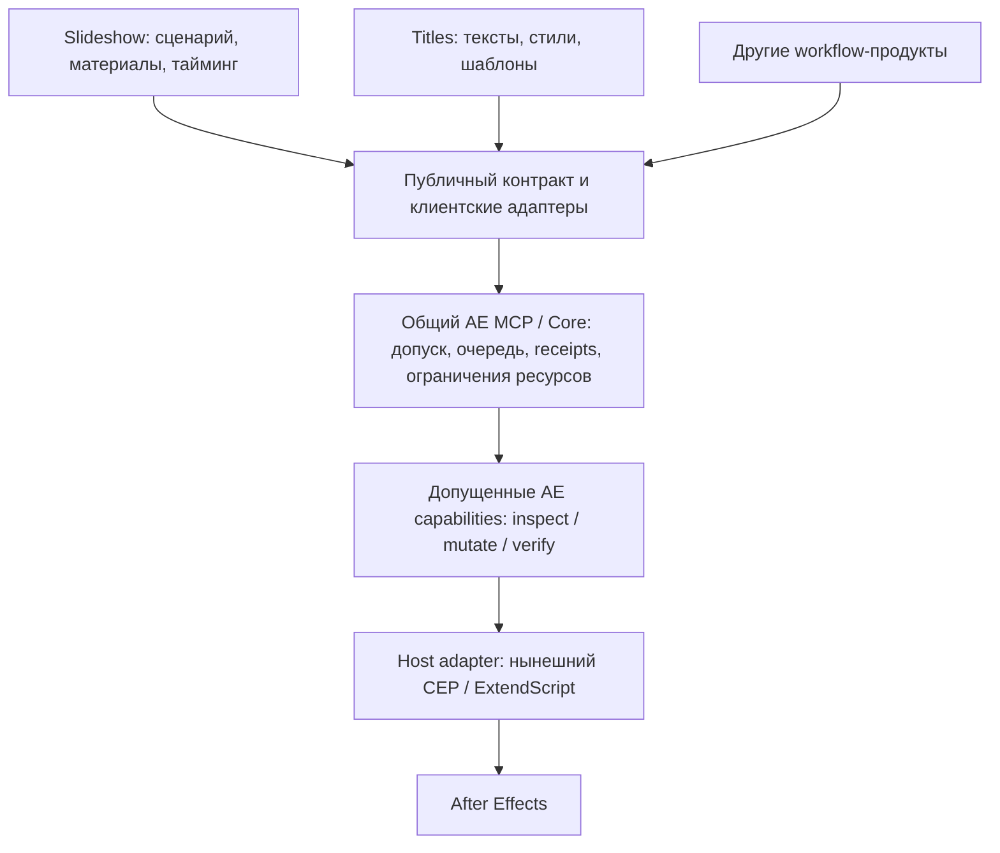

# Независимые workflow-продукты над AE Agent Core

29 октября 2026, Asia/Yekaterinburg. Статус: архитектурная рекомендация по запросу пользователя, не поручение реализации. Исследованный source snapshot: `70b340f6e7ecca81673c193a738fd741b43b3306`. Сравнение прежней системы выполнено по legacy-исходникам внутри текущего репозитория; внешний исторический AE_agent не менялся. Установленный runtime и пользовательский AE-проект не инспектировались и не изменялись.

## Рекомендация

Слайд-шоу, титры и будущие предметные продукты стоит развивать вне Core. У них должны быть собственные инструкции, входные задания, шаблоны, код построения плана, проверки, версии и рабочий контекст. Core при этом остаётся общим исполнителем с проверяемыми ограничениями, а не владельцем каждого пользовательского workflow.

Фраза «почти не относятся к Core» верна для продуктовой логики. На границе исполнения зависимость остаётся явной: версия публичного контракта, доступные операции AE, актуальное наблюдение цели, допуск исполнения, результат и восстановление после неизвестного исхода. Простое перемещение папок этой независимости не создаёт.

Для одного пользователя не нужны отдельный daemon, MCP-сервер и большой framework на каждую функцию. Хорошая начальная форма — самостоятельный workflow-пакет: skill/инструкция, схема задания, детерминированная библиотека или CLI, примеры и fixtures. Новый MCP имеет смысл только при собственной службе, независимых данных/очереди или нескольких потребителях, которым требуется его API.

## Границы

Это целевая схема ответственности. Готовая независимая установка capabilities, общий клиентский SDK и альтернативный host adapter здесь не объявляются реализованными.

| Уровень | Что ему принадлежит | Когда меняется |
| --- | --- | --- |
| Workflow-продукт | ТЗ, структура слайдов/титров, layout и тайминг, подбор материалов, шаблоны, compiler, проверка результата для пользователя | Новый шаблон, правила переноса строк, порядок сцен, формат задания |
| AE capability | Ограниченная операция, схема inputs/results, детерминированный server builder, фиксированный executor, проверка исходного состояния и результата | Требуется новая возможность AE или меняются её гарантии |
| Core и host adapter | Соединение, проверка допуска, единственный контроллер, журнал команд, resource ownership/fences, UNKNOWN и безопасное reconciliation | Изменение транспорта, протокола, AE host API или правил исполнения |

Продукт может владеть исходниками специализированной capability, но её исполнение проходит через доверенную установку и общий runtime. Изменение форматирования текста не должно требовать переустановки Core. Изменение привилегированного executor закономерно требует отдельной проверки и обновления допуска.

## Что уже существует и чего ещё нет

| Область | Факт по исходникам | Следствие |
| --- | --- | --- |
| Прежняя база | Startup imports slideshow/placeholder/montage/title-export и специальные ветки общего runner: `mcp-server/bridge-daemon.js:97`, `:7490`, `:7940` | Предметные workflows действительно были связаны с общей инфраструктурой |
| Core4 | Worker возвращает typed intent; broker проверяет evidence и сам формирует build/proposal: `core4/core/broker.js:148–200` | Это уже подходящая основа для внешнего compiler |
| Публичный ingress | Generic tools и module contracts: `core4/core/stdio.js:5–31`; build принимает до 16 шагов с module/contract/evidence/input | Для внешнего workflow над известной capability не обязательно добавлять privileged API |
| Узкие modules | Titles меняет существующий ограниченно поддерживаемый текстовый слой; photo заменяет источник существующего слоя. Полного slideshow в Core4 catalog нет | Нельзя называть эти capabilities готовыми продуктовыми фреймворками |
| Установочный состав | Exact список модулей/registry в `core4/runtime/stdio-entry.js:30–63`; только readonly/manual | Независимость source identity ещё не равна независимой установке executor |
| Состояние готовности | [Документ состава](core-installed-composition.md) прямо оставляет independent install/hot-swap будущей работой; automaticLifecycle unavailable | Внешний workflow не исправляет ограничения установленного runtime автоматически |
| Slideshow | Старые stages содержат до 50 legacy tool steps; Core4 принимает до 16 шагов module contracts | Понадобится адаптация capabilities и стадий с сохранением audits, fingerprints и ownership |

Практическая тонкость: нынешний runtime запущен как stdio-процесс и сам владеет физической связью. Второй broker получает отказ при занятом state owner (`core4/core/state-lock.js`). Поэтому «отдельный продукт» не означает «в каждом проекте запустить свою копию AE Core». Первый pilot должен компилировать данные отдельно, а выполнять план через существующего владельца MCP-соединения. Общая служба для нескольких самостоятельных клиентов — отдельная архитектурная задача, не необходимая предпосылка выноса бизнес-логики.

Нынешний CEP HTTP peer — канал панели, не публичный attach API для таких клиентов. В перспективе тонкие MCP frontends могут обращаться к одному broker через отдельный аутентифицированный local IPC с client/task identity, версионированием, backpressure и раздельной отменой задач. Отключение одного клиента не должно завершать общий runtime. Это только направление будущего контракта: выдавать workflow доступ к panel credentials вместо него нельзя.

## Найденные решения

Поиск выполнен по первичным источникам. Продукты не устанавливались; claims авторов и опубликованные тесты не заменяют собственную live-приёмку. Отсутствие гарантии в просмотренной документации не доказывает отсутствие её реализации.

| Решение | Полезная модель | Что брать в наше сравнение |
| --- | --- | --- |
| [Kumo Productions MCP](https://github.com/kumoproductions/mcp-aftereffects) | Небольшой MCP surface: 11 tools, ae_catalog/ae_do, динамический реестр typed операций, dryRun/batch, raw eval выключен по умолчанию. MIT | Наиболее близкий пример компактного discovery/API. Undo-группа не доказывает транзакционный rollback; эквивалент наших UNKNOWN/ownership гарантий не установлен. [Контракты](https://github.com/kumoproductions/mcp-aftereffects/blob/main/docs/TOOLS.md), [расширение](https://github.com/kumoproductions/mcp-aftereffects/blob/main/CONTRIBUTING.md) |
| [23d1 After Effects MCP](https://github.com/23d1/after-effects-mcp) | Широкий набор typed tools и ae_run_script; Windows AfterFX -r / macOS Apple Events, сериализация bridge calls. MIT | Альтернативный transport без обязательной CEP-панели; сравнивать поведение очереди, timeout и read-back отдельно |
| [Nexrender](https://github.com/inlife/nexrender) | Job JSON, assets/data substitution, aerender, server/workers и action plugins; основной проект MIT | Хороший образец самостоятельного продукта для пакетного шаблонного рендера. Не замена интерактивному управлению открытым AEP |
| [Dataclay Templater](https://support.dataclay.com/templater/content/home.htm) | Коммерческий продукт: подготовленный шаблон, данные, Bot и event scripts | Близок к массовому выпуску титров/персонализированных роликов. Может экономить разработку при совпадении сценария; требует собственной оценки стоимости и интеграции. [Источники данных](https://support.dataclay.com/templater/content/concepts/data/data_source.htm) |
| [Automation Blocks](https://aescripts.com/automation-blocks-for-after-effects/) | Коммерческий визуальный конструктор автоматизаций с библиотекой, JSX и HTTP/CEP triggers | Библиотека предметных рабочих процессов и визуальное редактирование; это другой уровень, чем MCP transport |
| [Comfy nodes](https://github.com/Comfy-Org/docs/blob/main/basic-concepts/nodes.mdx) | Workflow собирается из Core/custom nodes с inputs/outputs | Полезны независимые workflows и зависимости. AE изменяет общий документ: его side effects, partial success и ручные правки мешают перенести модель execution/cache буквально |

Дополнительно найдены [Dakkshin](https://github.com/Dakkshin/after-effects-mcp), [ku1x enhanced](https://github.com/ku1x/after-effects-mcp-enhanced), [irfanabdulhameed](https://github.com/irfanabdulhameed/aftereffects-mcp) и [maaz997](https://github.com/maaz997/after-effects-mcp). Это дополнительные MCP/ExtendScript bridges с разным охватом команд; для первого содержательного сравнения достаточно Kumo и 23d1, представляющих разные модели API. Количество инструментов или GitHub stars не использовать как доказательство надёжности.

Нет достаточного основания сейчас менять наш Core на сторонний MCP. Если пользователь в будущем предпочитает простоту установки более строгим текущим гарантиям, Kumo/23d1 стоит сравнить на ограниченном disposable AEP по одинаковым сценариям: timeout после send, поздний ответ, повтор, ручное изменение цели и частичный успех. Это предложение будущего эксперимента, не выполненная проверка и не запрет готовых решений.

## Новое внешнее ограничение: UXP

Adobe [официально объявила](https://blog.developer.adobe.com/en/publish/2026/09/investing-in-the-future-of-creative-cloud-extensibility-uxp-comes-to-our-flagship-applications) AE UXP public beta к ноябрю 2026 и прекращение включения CEP в новые версии с декабря 2029. ExtendScript этот переход не затрагивает. [AE UXP API documentation](https://developer.adobe.com/after-effects/uxp/) уже опубликована с оговоркой о beta.

Следствие для предлагаемой архитектуры: workflow должен знать семантику AE-возможности, а не детали CEP. Совместимость capabilities с новым host adapter надо проверять явно. Это не доказательство наличия стабильного UXP в установленной версии и не причина прямо сейчас ломать работающий transport.

## Минимальный путь

1. Зафиксировать продуктовую границу на примере внешнего Titles workflow: входное задание → чистый compiler → запрос к существующей titles-current-target capability. Начать с доступного узкого контракта, не с полного типографического движка.
2. Подтвердить offline, что изменение compiler не меняет Core/CEP bytes, ошибочная версия отклоняется до send, а удаление workflow не удаляет runtime receipts и ограничения. Compiler не запускает второй broker.
3. После отдельного разрешения на нужный live scope проверить один поддерживаемый случай через существующий MCP controller с текущими proposal/dry-run/confirmation/read-back gates. Без этого pilot не получает live PASS.
4. Следующим самостоятельным этапом сделать контракт поставки/admission capability. Не смешивать его с первым вынесением workflow и не обещать hot-swap, пока он не реализован.
5. Затем переносить slideshow по возможностям, сохраняя защиту source comps, ownership сгенерированных объектов, тайминг и partial-success/recovery. Простой перенос старого builder невозможен из-за несовпадения API и ограничений стадий.

Репозитории выбираются по реальным циклам выпуска: самостоятельные Titles/Slideshow могут иметь отдельные repos; несколько родственных шаблонов разумно хранить вместе. Граница определяется зависимостями и проверками, а не числом папок.

## Основные риски и критерии независимости

- Внешний workflow случайно превращается во второй контроллер. Критерий: один владелец AE-lane; отсутствие новых credentials/state copies.
- SDK растёт в новый монолит предметных функций. Критерий: общий слой содержит протокол/схемы/receipt handling; template/layout/timing остаются продукту.
- «Batch» скрывает частичный успех. Критерий: ограниченные операции, resource/effect sets, durable receipts; нет автоматического replay UNKNOWN или обещания rollback.
- Удаление пакета лишает возможности разобраться с неизвестным исполнением. Критерий: Core удерживает ledger/fences и доступ к закреплённому verifier либо честно сохраняет блокировку; удаление pinned artifacts не разрешает повтор.
- Перенос между компьютерами выдаётся за перенос исполнения. Критерий: code/contracts переносимы, credentials/authority локальны; фактическая приёмка по [portability](portability.md) остаётся открытой.

## Argon и локальная проверка

Единственная консультация отправлена через существующий контроллер: Aiton / 4 Argon / «Высокий — Глубокий», максимум из трёх доступных UI уровней. Один upload, один send, повторов нет. [Запрос](../reviews/argon/external-workflows/20261029-architecture-plan-01/request.md), [manifest](../reviews/argon/external-workflows/20261029-architecture-plan-01/manifest.json), [receipt](../reviews/argon/external-workflows/20261029-architecture-plan-01/submission.json), [чат Argon](https://gemini.google.com/app/8443e83ad4497380).

**Ответ получен при продолжении по прямому поручению пользователя.** Штатное чтение восстановилось, новых uploads/sends не было. [Полный неизменённый ответ](../reviews/argon/external-workflows/20261029-architecture-plan-01/response.txt): 60181 байт, SHA-256 `e97cb0c2d560a38ea6c60f1fde14d5d982c573548fa42f0c439f294c710d266c`. Review/stage/base/request/bundle string bindings совпали; это не доказательство независимого пересчёта хешей внешней моделью. Исторический блокер сохранён в retrievalHistory.

Argon поддерживает стратегию внешних продуктов, но даёт конкретному плану `revise`: 7 замечаний (3 P1, 3 P2, 1 P3). [Локальный разбор каждого](../reviews/argon/external-workflows/20261029-architecture-plan-01/decisions.md) уточняет преувеличения и не превращает рекомендации в автоматическое разрешение правок.

## Окончательный архитектурный вердикт после сверки

**Рекомендуется принять направление: самостоятельные прикладные workflow-пакеты поверх общего AE Core и отдельно допускаемых AE capabilities. План перехода скорректирован; реализация в этом блоке не выполняется.**

Начальная форма — изолированный пакет вне `core4/`, skill + схема задания + чистый compiler + fixtures, с использованием существующего MCP-клиента. Для проверки границы достаточно отдельной директории в текущем репозитории; отдельные repos выбираются по независимым циклам выпуска. Собственный SDK и MCP-сервер на продукт не являются предпосылкой. Первый pilot — узкий Titles, затем реальные требования титров и адаптация slideshow.

Независимость изменения внешнего compiler можно проверять при нынешнем фиксированном составе runtime. Независимость установки/обновления host capabilities пока не достигнута. Package/transport/contract identities сегодня связаны; их будущая декомпозиция требует явного учёта installation, peer, protocol, execution policy, admissions и закреплённых незавершённых команд. Простое удаление packageHash не принято как безопасное исправление.

Серверный build остаётся существующим доверенным швом: текущие builders малы, но это не доказывает необходимость немедленно удалить worker или перенести его обязанности в Core. Укрупнение batch-операций и замена legacy audits допустимы только после сопоставления их postconditions, protected resources и partial-failure semantics. Операции с несколькими мутациями не получают обещание атомарного rollback.

Уточнение порядка подтверждения: `run` проверяет пятисекундную свежесть dry-run до отправки; native confirm расположен в `titles-current-target/executor.jsx:54`, внутри mutate после отправки. Медленный агент между dry-run/run может получить штатный отказ, но длительность native confirm не является доказанным нарушением этого TTL. Перенос native confirm на proposal не принят.

Готовые MCP остаются источником паттернов и кандидатами для отдельных сравнительных испытаний. По материалам исследования оснований заменять Core сейчас нет; это не утверждение об отсутствии эквивалентных гарантий во всех сторонних продуктах.

## Progress / Decision Log / Validation

- Progress: исследованы локальные границы, выполнен поиск альтернатив; получен и локально разобран единственный Argon review, окончательная рекомендация уточнена.
- Decision Log: внешние продуктовые workflows и отдельно допускаемые capabilities; первый pilot без обязательного SDK/нового MCP. Удаление worker/package pins и перенос native confirm не приняты как готовые исправления. Решение о реализации ещё не принято; исходники runtime, installed config и AE не менялись.
- Validation: read-only source inspection и первичные web sources; payload/response hashes и bindings. После source snapshot изменились только два посторонних плановых документа (commit7d951c8), исследованные source bytes неизменны. Кодовые suites и live checks не запускались, поскольку production code не менялся. Пробелы: внешний pilot, independent capability install, multi-client routing и двухмашинная приёмка.
