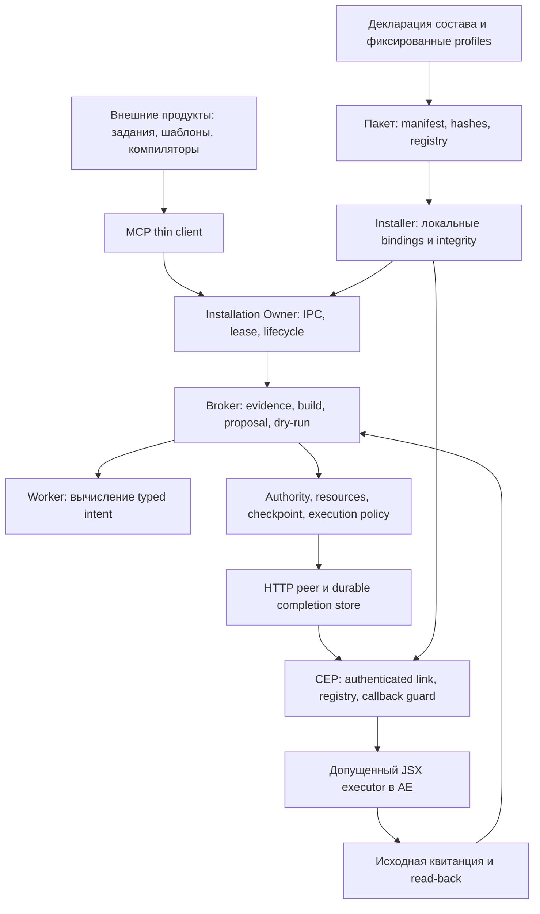

# Core 4.2.6: архитектурная сверка и план реализации

Дата: 12 ноября 2026. Назначение: проверяемое задание для нового чата реализации.
Рабочий корень: `C:/Users/Ant/Documents/Codex/AE_agent_core`.

## Решение

Сохранить существующую архитектуру. Выполнить ограниченное укрепление контрактов,
затем отделить описание состава от запуска runtime. Полная перепись, новый
универсальный plugin framework и переделка восстановления для этого не нужны.

Главная проблема — стоимость изменения: описание состава, проверка допуска,
генерация registry, выбор proof adapters и запуск процессов сосредоточены рядом.
Один новый профиль или версия затрагивает несколько списков и условных ветвей.
При этом разделение внешнего продукта, серверного допуска и физического исполнения
уже содержательное; его следует сохранить.

Реализация делится на три этапа:

1. **A — локальные гарантии:** ожидание close, диагностика bootstrap, граница builder input.
2. **B — состав и зависимости:** безопасное отделение чистого описания состава,
   полная ревизия каталога и проверка совместимости версий.
3. **C — связность и приёмка:** адресная проверка сквозного пути и применимости
   прежних результатов; подготовка пакета к отдельному выпуску.

Эта записка подготовлена по поручению на анализ и план. Исполнение source-этапов
начинается в новом чате по поручению пользователя. Она не назначает установку,
перезапуск AE, live-мутации или повтор старых команд.

## База и достоверность

- Product snapshot: `6d40cc228d9f2e18c672af5782033be305b82917`, Core **4.2.6**.
- HEAD при повторном разборе: `48576d1` — последующие коммиты аудита документальные.
  `git diff 6d40cc228d9f2e18c672af5782033be305b82917 -- core4 products` пуст.
- Ветка при подготовке: `codex/ae-panel-startup`. Уже изменены `AGENTS.md` и
  `plans/core-transfer-4.2.5-20261111.md`; эти изменения принадлежат другим работам.
- Основные evidence: [решения аудита](../reviews/architecture/20261112-current-01/decisions.md),
  [локальный Pro triage](../reviews/architecture/20261112-current-01/local-pro-triage.md),
  [локальный Argon triage](../reviews/architecture/20261112-current-01/local-argon-triage.md).
- Pro и Gemini дали `revise`. В Gemini модель была выбрана как Argon перед
  отправкой; после сбоя UI показывал Flash в следующем composer. Backend-модель
  ответа независимо не подтверждена. Решения ниже опираются также на локальный код.
- Повторно прочитаны ключевые полные функции broker execution/reconciliation,
  attachment shutdown, composition/release verification, bootstrap/latch, упаковки,
  client bootstrap, artifact/worker, ledger, product Titles и правила portability.
  Это разбор основных границ, а не утверждение о чтении каждой строки репозитория
  или формальное доказательство отсутствия всех дефектов.
- В этом проходе тесты, product build и live AE не запускались. Имена существующих
  тестов означают имеющееся покрытие в исходниках, а не новый PASS.

## Архитектурная карта



Стрелки показывают данные и wiring, а не передачу права на мутацию. Ни внешний
продукт, ни worker, ни manifest сами по себе не выдают authority.

| Составляющая | Проверенный вывод | Решение / остаточная граница |
|---|---|---|
| Внешние Titles/Slideshow | Titles компилирует данные, не импортирует runtime и не получает credentials | Сохранить. Художественные правила, шаблоны и задания остаются снаружи Core |
| MCP client и IPC | Thin client проверяет собственный release, отделён от panel credentials; EOF не должен останавливать Owner | Сохранить. Убрать зависимость клиента от runtime entry ради чтения composition после проверки пакета |
| Installation Owner | Общий процесс, controller lease, ограниченные роли и draining | Сохранить. Исправить нижний close, не переписывать maintenance/death protocol |
| Broker и plan engine | Сервер владеет evidence/build/proposal; перед dispatch повторно сверяет pins и цель | Сохранить. Закрыть добавление builder полей вне declared expectations |
| Authority и ресурсы | Private brands, grants, resource constraints, reservation и checkpoint имеют разные назначения | Не сливать в один флаг ready/approved; не переносить в product или JSON manifest |
| Modules и worker | Версионированные artifacts, admission, immutable copies, ограниченный worker IPC | Сохранить. Статический review кода и отдельный процесс не объявлять полноценной OS sandbox для враждебного кода |
| Composition и profiles | Выбор состава декларативный, но допуск новых result/effect profiles закреплён в trusted code | Это допустимая граница. Существующий profile переиспользуется декларативно; новая семантика proof требует reviewed adapter |
| Package / transitive closure | Упаковщик собирает прямые файлы и artifact closures, проверяет hashes и запрещённые пути | Сверять фактический manifest, а не только modules[] или размер исходников. Наличие файла не означает активный маршрут |
| Catalog identity | Revision может зависеть лишь от последнего добавленного manifest | Исправить семантику revision; package hash и module pins остаются отдельными identities |
| Bootstrap trust | Entry использует builtins до проверки дерева; check-boundaries охраняет порядок imports | Главная граница этапа B. Чистота функции не делает её файл доверенным до integrity verification |
| HTTP/CEP auth | Loopback/Origin/MAC/sequence и роли проверяются отдельно | Сохранить. Ограничение pre-auth challenge — liveness вопрос, не доказанный auth bypass |
| Registry и panel identity | Exact build/installation binding, callback guard и persistent latch | Исправить диагностику ошибки. Не снимать UNKNOWN и не повторять eval по timeout/throw |
| Native execution / resultProfile | Active HTTP route понимает профильные receipts; generic receiver имеет другой контракт | Зафиксировать таблицу маршрутов. Не ослаблять allowlists ради общего формата |
| Journal / recovery | Intent до send, durable completion, original binding, UNKNOWN/fences, no replay | Сохранить. Разделять доказательство завершения и простое совпадение текущих значений |
| Startup / host adoption | Есть отдельная capability запуска и доказательства привязки executable/panel | Текущее fresh read не доказывает cold/hot/repeat startup новой identity. Не возобновлять frozen MSIX root-rebase |
| Installer / переносимость | Код и пакет отделены от локальных state/config/credentials | Приёмка продукта на MSI; на десктопе адресная проверка переноса. Не повторять всю P1–P8 без причины |
| Render / media / external processes | Есть отдельные proof adapters и render-job capability; её присутствие зависит от состава | Не включать их в каждый состав ради удобства. Общие history/maintenance файлы могут быть нужны для сохранности прежних jobs |
| Версии и compatibility | Есть несколько exact-version allowlists; registryVerification включён проверкой `=== '4.2.6'` | Проверить переход версии явной матрицей. Не заменять ограничения широким semver >= |
| Observability / API ошибки | Различаются pre-dispatch отказ, completed rejection и unknown; G-01 теряет диагностический код | Сохранить фазу, исходный код и безопасное nextAction; диагностический текст не выдаёт recovery authority |
| Производительность / история | Sync fsync и линейные проходы существуют, текущий ущерб latency не измерен | Пока сохранить. Не вводить БД, compaction или обязательный reset без измеренного требования |

## Что меняется относительно внешних рекомендаций

1. AE-04 подтверждён для `runtime/attachment-owner.js:215`, но верхний
   `stdio-entry.js:462` уже имеет shared closing promise и maintenance fences.
   Общая поломка Owner shutdown не доказана.
2. G-01 — потеря `registry_refresh_failed` в `poll-dispatcher.js:99–115`.
   Сохранённый latch не является сам по себе дефектом: callback может быть
   неизвестен, а signed retirement уже есть. Первая правка улучшает диагностику,
   не вводит новый протокол автоматического разблокирования.
3. AE-07 — недостающая общая гарантия `added keys ⊆ expectedBindings` в
   `core/broker.js:173`. Текущий злонамеренный builder или обход действующего
   workflow не найден; нужен негативный fixture, а не объявление инцидента.
4. G-02 — неполнота change identity (`package-installable.js:75–82`),
   а не недетерминированная сборка одинаковых inputs. Исправление revision
   закономерно меняет package hash; обещать byte-identical пакет нельзя.
5. AE-06 не доказывает сломанный Titles. `core/receiver.js` действительно
   попадает в пакет через `core/artifact.json`; active HTTP route использует
   профильный validator. Удаление receiver только по этому замечанию неверно.
6. AE-01–03 — вопросы применимости evidence. Полные execute/reconcile paths и
   исторические проверки существуют. Missing excerpt не превращается в missing code.
7. Дополнение этого разбора: извлечение helpers затрагивает trust bootstrap,
   а exact-version ветви требуют проверки следующего выпуска. Это риски
   будущей реализации, не новые доказанные текущие аварии.

## Целевые контракты до начала реализации

### Close

Все вызовы после начала принятого закрытия ожидают одну underlying cleanup
операцию и получают одинаковый итог, включая rejection. Cleanup выполняется
один раз. Закрытие admission происходит до первого await. `owner_draining`
до начала cleanup не отравляет будущую допустимую попытку close. После ошибки
cleanup последующий вызов не превращает её в успешный no-op. Не требовать
объектного `===` у Promise, возвращённых async wrapper: важны lifetime и итог.

### Bootstrap diagnostic

Строго различать success callback, связанный error callback, malformed/foreign
callback, sync throw и отсутствие callback. Только существующий success
контракт вызывает `/registry-ready`. Связанный `registry_refresh_failed`
сохраняется как диагностический факт; он не означает, что Node получил
authenticated terminal outcome или что частично выполненный bootstrap можно
повторить. Persistent latch и signed retirement сохраняются.

Начальный scope не вводит `/registry-failed`, новый durable terminal state или
автоматическое clearing/retry. Если для передачи диагностики через существующий
status всё-таки понадобится новый wire format, это отдельный небольшой контракт
до кода, с перечислением отправителя, MAC, binding и совместимости.

### Builder intent

После существующей schema validation каждый ключ `intent.input` обязан быть
либо в исходном `desired`, либо в ключах `effectPolicy.expectedBindings`.
Исходные значения desired, target и expected bindings проверяются как прежде.
Нельзя легализовать произвольные optional schema fields только потому, что они
есть в inputSchema. Проверка действует и в initial build, и в materialize.

### Composition и identity

Чистые helpers получают данные/ограниченный read callback и возвращают данные
или registry source. У них нет процессов, сети, runtime state, credentials,
lease/grants или module-path imports из manifest. Runtime wiring и proof factories
остаются в доверенном адаптерном слое.

`catalogRevision` — версионированный digest окончательного выбранного состава:
composition identity, упорядоченных module entries с artifact/admission pins,
engine pin, assets/result profiles/capabilities. Поля и canonicalization фиксируются
в тесте и документе. Не включать revision в собственный preimage, timestamps,
machine paths или runtime IDs. Сохранять значимый порядок массивов; не обещать
одинаковый digest для перестановки, если контракт не объявляет её эквивалентной.

Revision меняется при изменении любого включённого предметного artifact/admission
или выбранного профиля; не меняется от правки невключённого модуля. Она не заменяет
release hash, coreIdentity, protocolPin, installationId или authority.

## Этап A — три малых изменения контрактов

Исполнитель реализации: Sol 6.1 High (`ae_implementer`), отдельные коммиты A1–A3.
При сомнении о bootstrap/authority — узкий `ae_specialist`, без общего redesign.

### A1. Lower close

- Ownership: `core4/runtime/attachment-owner.js`, нижний `facade.close()` в
  `core4/runtime/stdio-entry.js:718` и их адресные offline тесты. Direct stdio
  возвращает именно facade close; его concurrent/rejected cleanup имеет тот же
  подтверждённый дефект ожидания. Верхний `exposeOwner`/maintenance не менять.
- Ввести shared cleanup state/promise по контракту выше, не менять wire API,
  Owner lifecycle, leases или правила accepted/pending.
- Приёмка: два одновременных close при управляемом отложенном cleanup;
  один cleanup; оба ожидают; оба видят одинаковую ошибку; requests после начала
  закрытия отвергаются; draining до закрытия допускает последующий close.
- Для facade отдельно проверить отложенный и rejected `peer.close()`: ни один
  повторный caller не завершает ожидание раньше cleanup и не получает success
  после его ошибки. Поведение цепочки `peer.close`/`broker.close` при ошибке
  закрепить явно; не выполнять cleanup повторно ради получения успеха.
- Отдельно проверить верхний Owner wrapper; не исправлять его без контрпримера.

### A2. Registry diagnostic

- Ownership: `core4/cep/js/poll-dispatcher.js`, только необходимая диагностическая
  обработка `panel.js` и связанные VM fixtures.
- Распознать строго связанный error callback вместо потери кода в `invalid_frame`.
  Проверять nonce, version, точный allowed shape и текущий callback token.
- Если сохраняется дополнительный diagnostic record, он связан с прежним latch
  и не служит основанием удалить его, создать новую session или вызвать eval.
- Приёмка: success unchanged; matching error виден; wrong nonce/extra keys/raw
  parse error не маскируются как известный отказ; sync throw и missing callback
  не снимают guard; storage failure сохраняет отказ; signed retirement по-прежнему
  требует доказанный completed reset и архивирует исходный latch.
- Начальный этап не требует AE. Native proof назначается лишь для затронутого
  пользовательского обещания, если оно будет заявлено в выпуске.

### A3. Builder boundary

- Ownership: `core4/core/broker.js`, узкие broker/admission fixtures и необходимые
  artifact hashes через существующий sealing workflow.
- Негативный builder добавляет optional, schema-valid effect field, которого не
  было в desired и expectedBindings. Отказ происходит до публикации build/dispatch.
- Проверить expected bindings, сохранение desired, повторный materialize,
  payload с ошибочной целью и отсутствие физической мутации.
- Текущие законные builders сохраняют результат. Не расширять inputSchema и
  не доверять внешнему compiler заполнять серверные expectations.

## Этап B — состав без зависимости от запуска

### B0. Сначала контракт integrity bootstrap

Исполнитель: `ae_architect` или текущий явно выбранный пользователем архитектор.
Это адресная сложность проверки доверия, не основание переписывать весь startup.

Составить для каждого entry точную последовательность:
`read descriptor → verify pinned tree/path/root → load fixed helper → semantic
composition validation → lifecycle admission → construct runtime`.

Сейчас `verifyRelease` одновременно проверяет bytes и интерпретирует состав,
а `verifyInstallation` вызывает его до возвращения в `start`. Поэтому просто
добавить top-level import `composition-spec.js` нельзя. Принятый вариант для
реализации: оставить минимальную проверку bytes/paths/pins на builtins в bootstrap;
разрешить один фиксированный pure helper только после доказанной проверки
соответствующего дерева и его привязки к исполняемому entry. Одинаковое название
файла в source tree и installed tree не означает одинаковые доверенные bytes.

До перемещения кода зафиксировать поведение старых поддерживаемых пакетов,
в которых нового helper нет: отдельный явный legacy путь с прежними проверками
либо документированное сужение поддержки по отдельному решению. Не использовать
тихий fallback, произвольный dynamic require, eval или загрузку из cwd.
Если извлечение требует нового trust протокола, сократить B1 до post-verification
потребителей и оставить verifier inline; это допустимый ограниченный результат,
который нужно прямо отметить, а не ослаблять guard ради рефакторинга.

### B1. Извлечение и wiring

- Кандидаты: pure composition description, fixed profile metadata, registry source,
  installation config/marker derivation. Предлагаемые имена файлов —
  `runtime/composition-spec.js`, при необходимости `runtime/registry-source.js`.
- Consumers: package/install tools и проверенный client; runtime использует
  контракт B0. `stdio-entry.js` остаётся composition root для runtime процессов.
- Все imports proof factories остаются фиксированными и проверяемыми; manifest
  не получает поле с произвольным исполняемым путём.
- Update: source-package/closures, standalone closure, boundary checker и ровно
  затронутые tests. Sealing выполняется штатно; правка checksum не заменяет тест.
- Не объединять с переносом всех proof adapters по каталогам, удалением legacy
  receiver или переработкой shutdown/recovery.

Приёмка: package/install/client не импортируют runtime entry только ради metadata;
невключённые возможности не добавлены; corrupted/missing helper отклоняется до
его исполнения и создания runtime/state; old package compatibility имеет явный
исход; checker запрещает прочие early imports. Для чистого extraction должны
совпадать selected assets, catalog semantics, generated registry и tool surface.
Source file hashes и package hash могут измениться от перемещения кода.

### B2. Catalog revision и минимальный состав

- Вычислить revision один раз после окончательного выбора modules, admissions,
  engine, assets, profiles и capabilities. Убрать присваивание в цикле modules.
- Fixtures: два разных dynamic modules; изменение первого и последнего;
  изменение admission/profile/engine; изменение исключённого модуля; одинаковые
  inputs дважды; циклическое наследование/дубликаты/лишний файл → отказ.
- До/после сохранить объяснимый manifest diff: для каждого добавленного файла
  прямая причина либо dependency chain. Проверять минимум readonly/owner,
  manual/owner, manual-titles-variants/owner и затронутый operator состав.
- Не удалять общие render history/maintenance по одному названию файла:
  проверить обязанность новой установки обнаруживать прежние незавершённые jobs.
- Не обещать, что manual-titles-variants уже минимален: он наследует
  manual-titles → manual-layout → manual; оценить transitive features по
  объявленному сценарию. Изменение пользовательской поверхности — отдельный
  объяснимый diff, не скрытый побочный эффект extraction.

### B3. Совместимость версии и result profiles

- Явная таблица: product version, release format, composition policy version,
  owner/receiver contracts, registry verification и client/serverInfo.
- До изменения номера выпуска найти все exact-version ветви, включая
  `deriveComposition`, `verifyRelease`, `verifyPackage`, client entry и
  panel identity. Новая версия не должна молча выключать registry verification.
- Не включать произвольные будущие версии через `>=`; незнакомые formats и
  capabilities отклоняются. Старые проверенные форматы сохраняют свои требования.
- Матрица result routes: модуль → resultProfile → runtime proof → transport
  validator → completion/read-back. Generic receiver проверяется как отдельный
  поддерживаемый маршрут, если он действительно используется.
- Для существующего result profile добавление законного модуля должно обходиться
  декларацией/артефактом/admission без новой ветки Broker. Новый effect/proof —
  отдельное расширение trusted adapters; универсальный plugin ABI не требуется.

## Этап C — доказать затронутую связность

1. Использовать актуальный diff и existing validation map. Для каждого изменённого
   инварианта: какой fixture ловит нарушение, какой результат получен, какое
   историческое evidence применимо и что осталось непроверенным.
2. Проверить supported Titles path на offline harness: product prepare-build →
   contract/evidence → build/propose/dry-run → execution policy → соответствующий
   completion/read-back. Harness остаётся synthetic и не выдаёт production grants.
   Сначала найти подходящий существующий integration test; не плодить его копию.
3. Адресные failure transitions: stale input/pin; rejected before send; accepted
   then disconnect; lost callback; сохранённый result с потерянным ACK; restart с
   UNKNOWN. Во всех случаях не больше одного физического исполнения, повторная
   доставка receipt не превращается в повтор eval, новое владение не получает
   право продолжить старую неопределённую команду.
4. Сверить initialize/version/tools-list свежего offline client и состав пакета.
   Полный release suite нужен только если назначен выпуск, а не как бесконечный
   startup gate для каждой обычной content-задачи.
5. Если затем поручены установка и продуктовая приёмка: проверять на MSI один
   согласованный сценарий на собственном стенде; сохранить receipt, read-back,
   визуальный результат и освобождение lease. Для новой identity отдельно
   определить необходимость host adoption/startup proof. Не использовать
   существующий пользовательский AEP как удобный тестовый стенд.
6. Перенос принятого пакета на десктоп — штатный preflight/apply/read-back;
   повторять лишь затронутые границы. Frozen MSIX root-rebase остаётся frozen.

## Проверки и управление scope

Read-only mapping неизменённого product snapshot, полученный при подготовке:

| Изменяемый путь в core4 | Выбрано checks | Batches |
| --- | ---: | ---: |
| runtime/attachment-owner.js | 14 | 14 |
| cep/js/poll-dispatcher.js | 7 | 7 |
| runtime/stdio-entry.js | 30 | 30 |
| tools/package-installable.js | 12 | 12 |
| core/broker.js | 26 | 19 |

Это плановый объём, не результаты запуска. Наборы пересекаются; их нельзя
складывать как число уникальных проверок. В реализации пересчитать выбор
для фактического diff, включая новые файлы и sealing dependencies.

Из корня Core для адресного выбора:

```powershell
node core4/tools/validate-diff.js <changed-path> --run
npm.cmd --prefix core4 run check:boundaries
git diff --check
```

Сначала посмотреть mapping без `--run`, оценить выбранные проверки и применимость
reuse. Несколько общих файлов могут выбирать широкий набор — не запускать один
и тот же набор после каждой мелкой правки. Новый путь helper обязан попасть в
dependency mapping. Исключение большого набора обосновывается затронутой closure,
а не желанием получить зелёный результат. Не запускать live endpoints, installer,
Chrome или AE под видом offline теста.

Перед каждым commit: только свои paths, актуальные hashes evidence, scoped test
results, обновлённые Progress/Decision Log/Validation. Чужие dirty файлы не
нормализовать, не коммитить, не stash/reset. Один writer на файл, один live
контроллер; helpers получают immutable snapshot или явно выделенный scope.

## Отложено и почему

- G-03 recordContext без projectId: текущие AE modules используют projectId;
  решать при реальном non-project module, не выдавать metadata за authority.
- G-04 challenge fairness: сначала требование по локальной угрозе и liveness;
  не снимать лимиты/MAC/Origin и не нагрузочно тестировать живой endpoint.
- G-05 dev-entry version: явно dev metadata; можно исправить в отдельной
  согласованной правке версии, не считать текущий installed MCP старой версией.
- Ledger DB/compaction, распределённый owner, cross-machine execution state,
  новый browser bridge, общий plugin marketplace — вне нужного решения.
- Специальные случаи project-open timeout/media rejection в Broker — долг
  адаптерной границы. Переносить только при новом use case или измеримой выгоде,
  с тестом сохранения pre-dispatch/unknown семантики; не включать в A автоматически.
- Generic receiver не удалять по отсутствию его вызова в одном сценарии.
- Не возобновлять остановленный `core-msix-layer-recovery-20261112.md`, не
  перемещать foreign lower state и не повторять settled reset/install IDs.

## Definition of done

Source-работа завершена, когда A1–A3 и согласованный объём B выполнены отдельными
reviewable commits, контракты и затронутая closure проверены, фактический manifest
объяснён, C содержит результат интеграции и честный список непроверенных live
границ. Отсутствие live-приёмки не скрывается за offline PASS. Релиз/установка
отмечаются отдельно и не считаются выполненными самим созданием плана.

## Progress

- Повторная архитектурная сверка и план подготовлены; реализации A/B/C ещё нет.
- План подготовлен в чате «Настроить мост к Chrome». По прямому поручению
  пользователя продолжение и финальная проверка переданы в Core-чат
  «Провести аудит архитектуры» (`01a1cede-3e0f-7aa1-a375-be24e49bec1e`).
  Прежний чат подтвердил остановку, status idle; помощник завершён.
- Карта composition/test/validation собрана read-only по immutable snapshot
  `48576d1`. Независимый ae_reviewer проверил оба документа; единственный
  actionable P2 — пропущенный facade.close — включён в A1.
- Подготовлен [готовый запрос для нового чата](core-architecture-new-chat-20261112.md).

## Decision Log

- Перепись не нужна; порядок A → B → C уменьшает число одновременно меняющихся
  инвариантов. Крупные этапы делятся на малые отдельные commits.
- Bootstrap diagnostic отделён от решения о terminal outcome/recovery.
- Pure extraction допускается только с сохранением integrity-before-import.
- Версия продукта, schema capability, catalog revision и authority — разные
  понятия; не использовать одно как замену остальным.
- План не превращает старые acceptance gaps в обязательный gate каждой
  пользовательской задачи. Frozen работы остаются остановленными.
- Передача переносит инициативу, без новых browser/external/live действий.
  Текущий заказ завершает архитектурный план; source-реализация отдельно
  поручается пользователем. Создание нового чата автоматически не выполняется.

## Validation

- Source diff к снимку внешнего аудита пуст до правки этих документов.
- Проверены полные ключевые execution/recovery functions и потребители helpers.
- Чужие исходные dirty файлы исключены из области записи.
- Новых product tests/build/install/native/browser операций в этом проходе нет.
- После передачи независимый review обоих документов завершён; A1 уточнён
  для двух нижних close-путей. Source/test аргументы ограничены их семантикой;
  Windows signal shutdown сценарий не воспроизводился.
- Принимающий чат проверил относительные ссылки всех трёх документов и
  сохранность product source: diff core4/products к target пуст. SHA двух
  исходных dirty файлов совпали. Документальный staged diff проверен отдельно;
  product tests и live действия для этой финализации не назначались.
